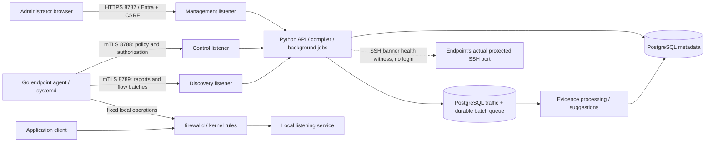
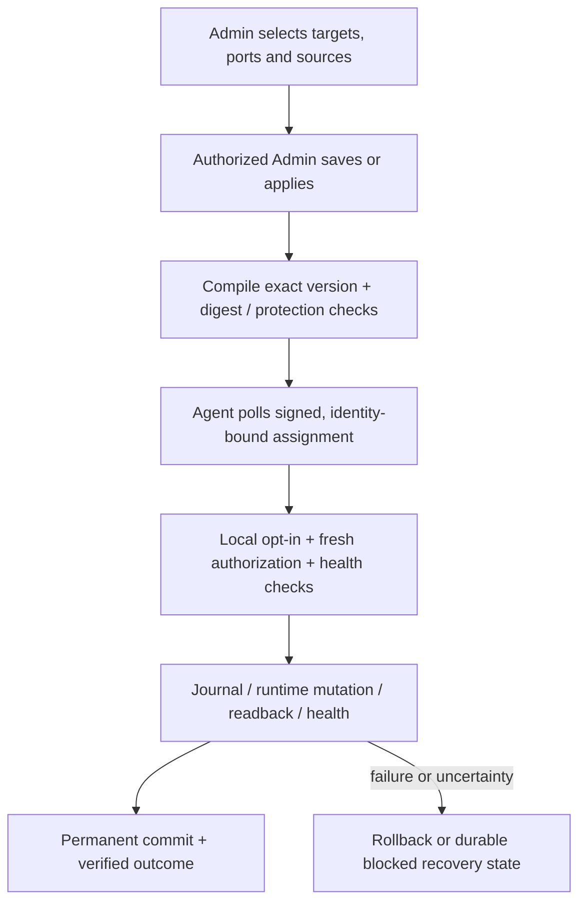

# Prṛthak · पृथक्

**Central firewall management and automation for Linux server microsegmentation.**

Prṛthak discovers servers and their real listening services, shows permitted source-to-service access, learns observed source/port relationships, and lets administrators review and apply firewalld changes centrally. The selected server is the destination: an access policy specifies **service/port + allowed sources**, without a separate destination field.

**Pilot candidate: [v0.7.0-pilot.3](https://github.com/everyagelabs/Prrthak/tree/v0.7.0-pilot.3).** The final local 5,000-identity test delivered a real Admin edit in **31.947 seconds**, including publication and a full 30-second poll window ([scope and evidence](docs/controller-capacity-5000.md)). Code workflows and isolated test evidence are separate from operational acceptance. The real 20-server pilot, native RHEL/Ubuntu matrix, live Entra tenant, DC/WAN failover and hardware-fencing checks remain pending. This repository does not claim production certification or a vulnerability-free application.

Private repository: [everyagelabs/Prrthak](https://github.com/everyagelabs/Prrthak). Product owner: **EveryAge Labs Private Limited**.

## What was requested, and how it works

The numbered register retains the original requirements and later explicit requests. Queues, signatures and connection pools support these features; they do not replace them.

### Inventory, policy, learning and visibility

| ID | Requested capability | How Prṛthak addresses it |
|---|---|---|
| R01 | A standalone project with Prṛthak branding and the requested red/white appearance | A separate controller, dashboard and endpoint-agent repository, with the bilingual product mark and a consistent interface. |
| R02 | Automatic enrollment and central inventory | A private GUI-generated setup file supplies a one-use enrollment token and public trust material. The agent creates its key locally, enrolls and reports inventory. |
| R03 | Discover actual services/ports and later changes | Socket, process and systemd discovery identifies services such as SSH on **2022**, rather than assuming port 22. New/changed listeners generate alerts. Fleet discovery defaults to **900 seconds**; an explicit 1–20-server pilot preset uses **60 seconds**. |
| R04 | Allowed sources per service; destination implicit | Each target receives an effective inbound TCP/UDP source/port policy. Whole-host default deny, egress and arbitrary forwarding policies are outside this adapter. |
| R05 | One policy for a group or matching tags | Static groups, dynamic groups and tag selectors resolve the target endpoints. Membership changes produce new desired policy versions and preserve the review boundary. |
| R06 | Reusable service groups and aligned source sets | A row can reference several saved ports and its own source CIDRs, source tags and source groups. Separate rows keep different source/port relationships separate. |
| R07 | Existing/common firewalld rules, broad openings, modify/remove/deny review | Runtime/permanent inventory and exact bulk previews support services, ports, validated rich rules, bounded INPUT direct rules and local port redirects. Permanent zone-target replacement is staged explicitly; it does **not** change the runtime target or reload firewalld. Unsupported routing/NAT, bindings and ambiguous contexts remain read-only. |
| R08 | Temporary learning and a last-hour source/port view | Bounded learning sessions stop capture on expiry. Separately, optional per-port hit monitoring can run until stopped and retain **1–24 hours**, with the last hour selected by default. Monitoring is disabled by default, reports coverage gaps and creates no access policy. |
| R09 | Per-port automatic learned access and visible generated policies | Fresh discovery freezes each host's eligible ports. The initiating Admin authorizes an exact initial scope; later observed source/port additions become separate learned policies automatically within that scope. Protected management ports are excluded. |
| R10 | Suggestions, selected-target review/apply and CSV export | Durable evidence produces recommendations, exact target previews and CSV exports. Admin grant changes apply directly; removals preserve suppression so later hits cannot silently recreate them. |
| R11 | Custom tags and one manually defined DC per server | Administrators assign business tags and a saved location centrally. An agent does not invent application/DC classifications. |
| R12 | Individual/bulk assignment and exact-IP CSV profiles | Reviewed forms and CSV imports show before/after values. Profiles can cover enrolled addresses or future endpoints without fabricating enrolled identities. |
| R13 | Subnet DC assignment, nested exceptions and IP/DC conflicts | Precedence is **manual override → exact-IP CSV → longest matching subnet**. Conflicting DC claims for a reported IP are withheld. Same-DC VIP/duplicate addresses are allowed; ambiguous CSV ownership is rejected. |
| R14 | Combined filters and clickable overview counts | Values within a category use OR; categories use AND. Policy filters apply before database pagination, with explicit totals and lazy exact details. |
| R15 | Separate pages and a top-right user menu | Overview, Servers, Locations, Services, Firewall, Policies, Traffic, Alerts, Activity, Settings and Users & access have dedicated navigation. Profile and display preferences use the account menu. |
| R16 | Advanced DC/cloud graphics, status pulses and communication lines | A bounded topology shows DC containers, current endpoint health, observed links and recent events. Historical links stay labelled; motion can be paused and respects reduced-motion preferences. |
| R17 | Alert when a previously-up or policy-allowed service is down | Prior listener disappearance, explicit expectations and ports permitted by effective ordinary/learned policy intent are checked. A changed policy expectation requires a successful **post-change fresh scan**. Stale/offline/failed discovery means unknown; withdrawing an expectation is not labelled service recovery. |
| R18 | Unexpected/closed-port and possible lateral-movement alerts | Opt-in closed-port observations feed single-host probing and bounded **same-source, same-port/protocol, multi-host** correlation. Alerts identify possible activity, destinations and coverage limits; they do not prove compromise or automatically block sources. |
| R19 | Managed enforcement, lockout protection, rollback and history | An authorized Entra Admin's Save/Apply directly publishes exact signed intent. Endpoint opt-ins, current authority, SSH/controller health checks, mutation journals and rollback still guard live changes. Desired, applied and uncertain outcomes remain distinct. |

### Installation, platform operations and rollout

| ID | Requested capability | How Prṛthak addresses it |
|---|---|---|
| R20 | Configurable agent URLs, timing and scoped central polling | GUI settings and reviewed endpoint configuration cover trusted origins, management protections and security opt-ins. Global/group/tag/server overrides have desired/applied receipts. New GUI kits/fleet defaults use **30-second control / 900-second discovery**; a reviewed selected-server pilot preset uses **30/60** without changing fleet defaults. |
| R21 | A lightweight RHEL/Ubuntu service and installers | A compiled Go systemd agent needs no endpoint Go/Python runtime. Family installers consume a private setup file and check prerequisites. Optional inert RPM/DEB payloads deliver the verified release before explicit activation. Native OS acceptance remains a separate gate. |
| R22 | Preserve inventory IPs despite control-path NAT | Inventory uses authenticated agent-reported interface addresses, not the HTTP peer address. Application traffic retains the source IP observed by the destination kernel. Original clients behind application-path NAT need separate network mappings/logs. |
| R23 | Entra SSO, exactly three roles and Super Admin ownership of users | Read Only, Admin and Super Admin are enforced by the API. Admin manages servers/tags/policies directly; Super Admin additionally manages application users and platform/security settings. Actions retain individual Entra attribution. |
| R24 | GUI configuration with one installer command and no manual file editing | `--gui-setup` creates protected initial configuration; Settings handles initial verified Entra setup and runtime settings. Agent setup downloads and reviewed configuration transitions avoid hand-editing agent JSON. OS preparation and secure credential/file retrieval still require the host operator. |
| R25 | Multiple controllers/DCs, shared data and GUI joining | The same appliance installer supports a shared PostgreSQL/etcd/Patroni deployment, reviewed joining and management-only members after the three DB voters. Real DC/quorum/fencing acceptance remains pending. |
| R26 | GUI cluster credentials and service operations | Fixed local-manager actions manage supported service operations and staged replication-password rotation with per-voter barriers and fresh authentication verification. A queued action is not reported as applied. |
| R27 | GUI data-root/storage management | Typed, reviewed storage operations preserve ownership, persistent state and rollback boundaries through the fixed manager. |
| R28 | GUI PEM/PKCS#12 certificates and hostname generation | Preview validates certificate/key pairing, validity, names and chains; activation uses strict readiness and rollback. Trust changes are explicit, and private keys/passwords are not returned in public state. |
| R29 | GUI public application-port changes | Exact typed reviews change the local public listener, retain binding scope and verify TLS/DB readiness. Failed transitions compensate; external LB, DNS, agent URLs and Entra registrations are separate dependencies. |
| R30 | Backups, schedules and recovery controls | Private verified database archives, durable daily/weekly/interval scheduling, owned scheduled retention, inspection and guarded recovery workflows are supplied. Destructive recovery retains explicit confirmations by the same authorized actor. SQLite and PostgreSQL have separate recovery paths. |
| R31 | A button to safely remove default/demo data | Preview counts and fingerprint bind a typed confirmation. A verified backup precedes removal of known synthetic fixtures; real data and edited/shared dependencies are protected or block cleanup. |
| R32 | 5,000 servers with policy delivery inside 60 seconds | The controller has bounded public projections, incremental reports and post-fork PostgreSQL pools. Capacity evidence states the exact local fixture/profile. Fresh 0.7 validation and real endpoint/DC acceptance are separate; this is not a fleet-wide enforcement guarantee. |
| R33 | Agent/controller CPU, RAM, packages, VM and Git details | The sizing section below distinguishes historical measurements from planning allocations. Source, installer and package workflows are in this private repository. |
| R34 | Application-security review, vulnerability assessment and code fixes | Scoped source review, adversarial regressions, static/dependency checks and remediation reports are maintained. Tool warnings are triaged; passing tests or scans do not establish that no vulnerabilities remain. |
| R35 | Prepare a 20-server pilot, with native/DC tests later | Start with one controller and monitoring, enroll a small mixed fleet, review inventory/evidence and exercise approved changes gradually. The actual pilot and deferred infrastructure tests are not claimed as completed. |
| R36 | One illustrated explanation of prerequisites, roles, ports and flows | The linked requirements map, architecture handbook and onboarding guide cover the workflows and their acceptance boundaries. |
| R37 | Separate management, control and discovery communication ports | Installed listener roles separate browser/admin traffic (**8787**), agent policy/authorization (**8788**) and agent enrollment/report/flow uploads (**8789**). The API admits routes according to the actual listener, not a caller-supplied header. |
| R38 | Application groups such as Platform, Billing and Payments | Saved static/dynamic application groups support inventory browsing, target/source selection, policies and scoped operations. Future matching enrolled servers can join dynamic groups. |
| R39 | Protect installed code and trace releases to Git | Compiled agents, restricted read-only containers, pinned image identities, detached Ed25519 signatures and startup integrity checks reject changed release bytes. Root/Git owners retain authority; this is not complete source encryption. See [release integrity](docs/release-integrity.md). |
| R40 | Risk & compliance findings with reasons and recommendations | A customizable catalogue starts with **29 source-backed risky-port rules**. Passive evaluation uses the latest agent-reported listeners and shows reasons/recommendations. CERT-In/RBI mappings identify operational evidence gaps; findings do not automatically block traffic or certify compliance. |

## Architecture and communication



Business packets go directly to the destination server; the controller is not a traffic proxy. The agent exposes no inbound command listener. Its existing SSH service must be reachable from the approved health-witness source when a workflow requires an SSH banner check; this is not an SSH shell login.

| Channel | Default | Identity / purpose |
|---|---:|---|
| Management | TCP 8787 | Browser HTTPS, Entra sessions, roles and CSRF-protected operations |
| Control | TCP 8788 | Endpoint mTLS; policy polling, authorization/configuration witnesses and renewal |
| Discovery | TCP 8789 | Token/CSR enrollment, then endpoint mTLS for reports and durable flow uploads |
| SSH health witness | Actual protected SSH port, e.g. 22 or 2022 | Read-only banner verification during applicable enforcement checks |
| Local privileged manager | Private Unix socket | Fixed reviewed host operations; no arbitrary shell/file API |

Private appliance backend, PostgreSQL and quorum ports are infrastructure-only; see [HA networking](docs/ha.md). Preserve endpoint certificate identity through any approved external L4 routing. The stable FQDN, external DNS/LB, site affinity and network ACLs remain operator infrastructure.

### How a policy becomes a firewall change



**Monitor is the installation default.** An authorized Admin's Save/Apply publishes the desired change directly; opted-in endpoints pull and apply it automatically through the checks above. Applied receipts show the actual outcome. Security opt-ins remain explicit local configuration, supplied through a GUI-generated signed kit; saving an ordinary policy does not silently enable them. Explicit imported deny/restrictive changes and destructive recovery retain extra same-actor confirmations.

### How learning becomes a policy

1. Select hosts/groups and optionally a port such as `443/tcp`.
2. Request fresh per-host discovery and freeze only eligible selected ports.
3. Capture temporarily; show exact observed source, destination host, port, protocol, counts, times and coverage.
4. Review recommendations for selected targets, or enable the exact initial auto-allow scope and expiry as an authorized Admin.
5. Auto mode adds eligible observed `/32` or `/128` sources only to the exact port/protocol hit. Individual hits do not need another human approval.
6. Stop/expiry removes owned capture rules and ends new automation. Committed learned grants remain until reviewed edit/removal.

An additive learned allow does **not** restrict other sources while a broad existing firewall opening remains. Observed clients are not automatically trustworthy, and rate-limited logs are not a complete connection ledger.

### Optional ongoing port hit monitoring

In **Traffic**, an administrator can review a frozen endpoint/port scope, enable monitoring and inspect source IPs, ports, counts, timestamps and CSV exports for the last hour or another retained window up to 24 hours. Monitoring is disabled by default and separate from temporary learning: it generates no suggestions or access grants. Short signed capture leases, bounded logging and explicit capture/cleanup receipts expose interrupted or incomplete coverage. Stopping the monitor ends new capture; retained observations age out under the selected retention.

## Install and configure through the GUI

Use an independently verified release from the private repository on prepared Linux hosts. The source checkout is not an offline image bundle. Approved OS/container access, persistent storage, trusted TLS/DNS, time synchronization and secure file transfer are prerequisites.

### Controller

From the verified release directory, run the installer once:

```sh
sudo ./scripts/install-controller.sh --gui-setup
```

The installer detects a safe management address, preserves installed identity on rerun, and prints the setup URL plus the **path** of the private initial Super Admin credential. Retrieve it through the approved privileged channel; its value is not printed. Verify initial TLS trust before signing in.

In **Settings**, configure the approved hostname/certificate, initial site/origin, candidate-verified Entra sign-in, runtime profile, storage and other platform settings. The fixed manager writes protected files and performs supervised changes. There is no anonymous remote setup wizard or generic `.env` editor. Existing Entra provider/secret/callback changes and joined-profile convergence now use reviewed, supervised migration: the authorized Super Admin verifies the candidate sign-in, saves/applies the exact change, and each registered controller verifies readiness before shared cutover. Keep old credentials and HTTPS aliases available for rollback. External DNS/LB changes and live-tenant acceptance remain deployment work. See [provider migration](docs/authentication.md#active-provider-changes-rotation-and-joined-convergence).

### RHEL or Ubuntu endpoint

Use **Install agent** to select the OS family/architecture and download a fresh private setup file for that endpoint. Transfer it securely with the matching verified package, then run **one** matching command:

```sh
sudo ./scripts/install-agent-rhel.sh --setup-file /root/prthak-agent-setup.json
```

```sh
sudo ./scripts/install-agent-ubuntu.sh --setup-file /root/prthak-agent-setup.json
```

The file contains a one-use enrollment token and public trust/configuration material, not an endpoint private key. Keep it private. The endpoint creates its own key. Family installers check prerequisites; OS package installation and competing firewall-manager migration are separate operator work.

After the first authenticated report, verify real addresses and listeners in **Servers**. Apply business tags/locations centrally. Use the endpoint's reviewed configuration workflow to change origins, management protections or security opt-ins without editing JSON. A downloaded transition or queued request becomes effective only after the exact endpoint receipt and required checks.

See [GUI pilot installation](docs/pilot-gui-installation.md), [Linux agent installation](docs/linux-agent-installation.md) and [optional RPM/DEB payloads](docs/native-agent-packages.md). Native packages only deliver versioned files under /opt; the reviewed family command still performs activation.

## Roles and business metadata

| Role | Responsibility |
|---|---|
| Read Only | Inspect permitted inventory, policies, traffic, alerts and review history; cannot mutate access or platform settings |
| Admin | Add, edit and delete servers/tags/groups/policies; save and apply supported firewall and learning actions directly |
| Super Admin | Admin capabilities plus application users/roles and privileged platform/security operations |

An authorized Admin saves/applies normal server, tag and policy changes directly, with no checker or selectable approval mode. Signed exact scope/digests, live role/provider authority, local enforcement opt-ins and rollback remain mandatory. Explicit imported deny/restrictive changes, restrictive learned edits/removal and destructive recovery retain separate confirmations by that same actor. Super Admin handles application users and privileged platform operations. Initial and changed Entra configuration still require verified candidate sign-in and supervised readiness. Shared tokens remain restricted lab mechanisms.

A server has one saved DC/cloud location and multiple tags, for example `application=Billing`, `network_zone=Production` and `criticality=High`. Manual values remain pinned until returned to automatic. CSV/subnet conflicts are shown, and renaming a location preserves its immutable ID and targeting. Reported IPs are authenticated claims, not cryptographic proof of network ownership.

## Expected CPU, RAM and storage

These are **planning allocations**, not measured ceilings or a production sizing guarantee.

### Endpoint agent

| Item | Evidence / starting allowance |
|---|---|
| Historical agent RSS | **10.42 MiB median; 12.50 MiB maximum** |
| Historical agent + active helpers | **56.79 MiB sampled peak** |
| Historical stabilized CPU | Agent alone **0.046% of one core**; including completed helper CPU **0.216% of one core** |
| Monitoring reserve | **128 MiB RAM** starting estimate for the agent and its helpers |
| Learning reserve | **256 MiB RAM** starting estimate; traffic volume/source cardinality can change the requirement |
| CPU reservation | A dedicated core is not required by the historical passive sample; discovery/learning bursts and current-release utilization remain unqualified |

The historical sample was **95 seconds in an Ubuntu 26 ARM64 container**, with an empty policy and **60/900-second** timing. It predates 0.7 and excludes firewalld, kernel memory and learning workloads. Sampled peaks are not hard limits. New GUI defaults use 30/900 seconds, so the historical sample is not a measurement of that current workload. Host firewall/kernel and business application resources need their own allowance.

The selected-server **30/60-second pilot preset** and optional continuous monitoring also need fresh CPU/RAM measurement on the target hosts. Neither changes the 900-second fleet discovery default automatically.

### Controller and database nodes

| Deployment role | Starting CPU | Starting RAM | Initial persistent data allocation |
|---|---:|---:|---:|
| Single-controller 20-server pilot | **4 vCPU** | **8 GiB** | **100 GiB SSD**, plus an **80 GiB OS/Docker disk** |
| 5,000-endpoint management-only controller | **8 vCPU** | **16 GiB** | **100 GiB SSD** per node; size OS/images separately |
| Combined controller/PostgreSQL/etcd voter | **8 vCPU** | **32 GiB** | **300 GiB SSD** per node; size OS/images separately |

HA starts with **three distinct-site DB/quorum voters**, one per DC; additional members can be management-only. The current managed installer co-locates these components on voter hosts. An independently dedicated database topology is not a drop-in change to that installer.

Controller CPU utilization is workload-dependent and has not been qualified as a fixed percentage. Discovery cadence, source/policy cardinality, simultaneous reports, observation volume, retention, HA synchronous writes and backups affect CPU, RAM and disk. Size backup storage separately and monitor growth before expanding the pilot.

## Platform operations and recovery

Settings exposes backup creation/inspection/download, durable schedules, retained scheduled archives, demo cleanup, certificates, supported service operations, storage, runtime configuration and application-port changes. Private operations execute through fixed manager/supervisor actions, with exact previews, typed review and truthful pending/applied/rolled-back states.

Database backups are sensitive and node-local unless an explicitly shared location is configured. They exclude the PKI private keys, vault key and external Entra secrets: those need separate protected recovery. Structural/checksum validation is not the same as performing a restore. Reviewed restore paths fence writers, preserve current security high-water state and require matching protected material; offline disaster recovery without that current safety state cannot claim to recover unknown later revocations safely.

The HA stack uses PostgreSQL replication and etcd/Patroni coordination. Strict synchronous durability can block writes when required standbys are unavailable. External routing, approved watchdog/reset behavior, WAN latency, site partition and fencing must be tested in the actual deployment. Do not enable endpoint enforcement/automatic learning on controller, database or LB infrastructure before its dedicated ingress-protection acceptance.

## Supporting implementation

- **Go endpoint:** local discovery, mTLS, signed assignment validation, replay floors, bounded private spool/cache, fixed firewalld operations, mutation leases/journals and cleanup.
- **Python controller:** API, authentication/roles, compilation, exact review authority, ingestion, health, scheduling and supervised platform operations.
- **Static JavaScript/CSS dashboard:** combined filters, compact paged catalogues, lazy canonical review details, topology and operational forms.
- **Storage:** SQLite for local development/standalone paths; separate PostgreSQL metadata and traffic stores for managed shared deployments. Durable receipts deduplicate retried uploads.
- **Delivery safety:** per-request identity/revocation and deployment guards, post-fork bounded DB pools, immutable versions/digests and explicit desired/applied outcomes.

These choices support the requirements above. They are not substitutes for the requested workflows or operational acceptance.

## Documentation, evidence and development

The illustrated PDFs describe earlier snapshots and remain historical guides. Current 0.7 behavior and acceptance limits are recorded in these Markdown documents and the final release evidence.

- [User requirements and delivery map](output/pdf/prthak-user-requirements-and-delivery-map.pdf)
- [Architecture and operations handbook](output/pdf/prthak-architecture-operations-guide.pdf)
- [Illustrated deployment and onboarding guide](output/pdf/prthak-deployment-onboarding-guide.pdf)
- [API contract](docs/api-contract.md), [architecture](docs/architecture.md) and [authentication](docs/authentication.md)
- [Managed enforcement](docs/managed-enforcement.md), [imported firewall management](docs/firewall-management.md) and [policy signing](docs/policy-signing.md)
- [Controller sizing](docs/controller-vm-requirements.md), [5,000-server capacity](docs/controller-capacity-5000.md), [scale evidence](docs/scale-validation.md) and [Linux validation](docs/linux-validation.md)
- [0.7 review remediation and remaining gates](docs/review-remediation-0.7.md) and [optional native endpoint packages](docs/native-agent-packages.md)
- [Risky-port catalogue and CERT-In/RBI operational mapping](docs/risky-ports-regulatory.md)
- [HA and recovery](docs/ha.md), [security model](docs/security.md) and [scoped security assessment](docs/security-assessment-2026-10-31.md)

The repository contains `controller/`, `agent/`, `dashboard/`, `deploy/appliance/`, installers/package scripts under `scripts/`, and controller/dashboard/integration tests. Contributors can run `make test`, `make check` and the isolated opt-in integration suites with the documented dependencies. PostgreSQL acceptance requires dedicated test databases; a demo/test UI is not evidence that a real fleet was modified.

Keep runtime databases, `.local/`, private setup files, secrets, keys, certificates, backup archives and environment files out of Git. Review packaged artifacts and release trust separately from source commits. Final release evidence must state its source revision, configuration, test scope and any skips; fresh 0.7 aggregate results are recorded after the release checks finish.

**Acceptance still pending:** the real 20-server pilot; native RHEL/Ubuntu deployment matrix; live Entra tenant; actual DC/WAN partitions and watchdog fencing; real 5,000-endpoint lifecycle/enforcement workload; and independent deployment-specific security assessment. Isolated tests and local capacity fixtures do not close those gates.

---

© 2026 EveryAge Labs Private Limited. All rights reserved.
