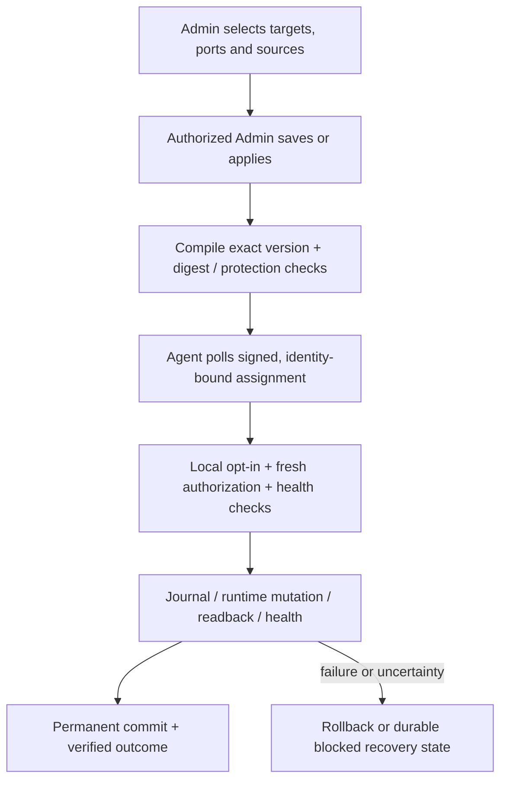

# Prṛthak · पृथक्

**Central firewall management and automation for Linux server microsegmentation.**

Prṛthak discovers servers and their real listening services, shows permitted source-to-service access, learns observed source/port relationships, and lets administrators review and apply firewalld changes centrally. The selected server is the destination: an access policy specifies **service/port + allowed sources**, without a separate destination field.

**Current main source is 0.18.24 (unreleased).** A dedicated **Tags & groups** page creates reusable tags and server groups, shows group/member counts and server names/IPs, and provides searchable tag selection for individual/bulk assignments and filters. Discovered services sort alphabetically. Traffic session history is hidden until requested. Agent fixes address the recorded RHEL 10 stock IPv6/Tailscale layouts, RHEL 8 denied UDP logs, active capture timestamps and transient listener changes during reviewed Stop. Private service namespaces require bounded loopback-only topology proof; routed or unreadable namespaces stay blocked. These compatibility fixes require native acceptance on the upgraded build. The latest published offline package remains [v0.18.23-pilot.1](https://github.com/everyagelabs/Prrthak/releases/tag/v0.18.23-pilot.1).

**Prior signed pilot candidate: [v0.17.0-pilot.1](https://github.com/everyagelabs/Prrthak/tree/v0.17.0-pilot.1).** [Installer validation and acceptance limits](docs/release-0.17.0-pilot.1.md). Use one controller command and one agent command across the supported RHEL/Ubuntu hosts. The installers detect the OS and prepare their dependencies automatically; all application settings stay in the GUI. Start from independently verified, protected release files and a GUI-generated private agent setup. Native OS/DC acceptance remains pending.

**Earlier signed pilot candidate: [v0.16.0-pilot.1](https://github.com/everyagelabs/Prrthak/tree/v0.16.0-pilot.1).** Its [release validation](docs/release-0.16.0-pilot.1.md) records the prior appliance hardening and permanent built-in admin work; those measurements are not relabelled as a new 0.17 run. Fleet enrollment still uses one reusable GUI setup and a unique identity per server, with expiry/revocation and no fixed registration-count limit. Local/SAML login, the [audit fixes](docs/audit-remediation-0.14.md), [bulk rollout verification](docs/policy-rollout-verification.md), duplicate bypass, automatic tag/group tracking and [GUI source-set preparation](docs/source-bank-preparation.md) remain in place.

Private repository: [Prṛthak](https://github.com/everyagelabs/Prrthak). Product owner: **Airtel Payments Bank**.

**Start with pictures:** [Install the controller](docs/guide/simple/controller-installation.html) ([PDF](docs/guide/simple/controller-installation.pdf)) · [Install the agent](docs/guide/simple/agent-installation.html) ([PDF](docs/guide/simple/agent-installation.pdf)) · [All requested features in simple language](docs/features-in-simple-language.md). The picture guides show the 0.17 screens. Use the [0.18 command sheets](docs/installation-commands.md) and current OS table for installation. The two guides are separate: prepare the control room first, then add your servers. VM/network preparation and verified release staging come before the one installer invocation; configuration is then done through the GUI.

**Starting with a fresh machine?** Follow the [installation commands](docs/installation-commands.md). After verified extraction, run `sudo ./scripts/install-controller.sh` on RHEL 9/10 or Ubuntu 26.04, or `sudo ./scripts/install-agent-auto.sh --setup-file /root/prthak-agent-setup.json` on RHEL 8/9/10, Rocky Linux, AlmaLinux and Oracle Linux 8/9, plus Ubuntu 22.04/24.04/26.04. Controller setup prepares Python/Docker/Compose; agent setup prepares required network/firewall packages with journaled service-start suppression. No dependency checkbox or OS-family selection is required for the automatic entrypoint. Existing UFW/firewalld activity is preserved; native OS execution remains pending.

For a RHEL 9 x86_64 controller VM without internet access, use the signed GitHub Release archive and the [offline installation steps](docs/offline-controller-installation.md). RHEL 10 source installation uses its approved native repositories. A complete RHEL 10 offline installation bundle additionally requires its Docker dependency closure from an approved EL10 repository. RHEL 9 dependency archives are restricted to RHEL 9.

**Local + SSO authentication in current source:** fresh empty installations offer temporary `admin` / `admin` as Super Admin, with a mandatory password change before workspace access. Local users, Microsoft Entra OIDC and configured SAML use the same three roles. Only Super Admin provisions accounts and grants roles. The built-in `admin` cannot be deleted, disabled, renamed or demoted; password changes/reset and session revocation remain available. See [Local and SAML login](docs/local-and-saml-login.md) and the current controller picture guide above. The older combined pilot guide remains an unchanged historical baseline.

[0.13 rollout verification](docs/release-0.13.0-pilot.1.md) · [0.12 GUI completion release](docs/release-0.12.0-pilot.1.md) · [0.11 endpoint/health](docs/release-0.11.0-pilot.1.md) · [0.10 fleet enrollment](docs/release-0.10.0-pilot.1.md) · [0.9 capture/security release](docs/release-0.9.0-pilot.1.md) · [Whole-server default-deny workflow](docs/whole-server-default-deny.md).

## What was requested, and how it works

The numbered register retains the original requirements and later explicit requests. Queues, signatures and connection pools support these features; they do not replace them.

### Inventory, policy, learning and visibility

| ID | Requested capability | How Prṛthak addresses it |
|---|---|---|
| R01 | A standalone project with Prṛthak branding and the requested red/white appearance | A separate controller, dashboard and endpoint-agent repository, with the bilingual product mark and a consistent interface. |
| R02 | Automatic enrollment and central inventory | One reusable GUI-generated fleet setup supplies an expiring/revocable enrollment key and public trust. Each host creates its own local key/certificate and reports automatically. Optional individual one-use kits remain available. |
| R03 | Discover actual services/ports and later changes | Socket, process and systemd discovery identifies services such as SSH on **2022**, rather than assuming port 22. New/changed listeners generate alerts. A native daemon checks listener changes every **5 seconds** (normally about **5–10 seconds** before reporting). Full OS/firewall discovery defaults to **900 seconds**; an explicit 1–20-server pilot preset uses **60 seconds**. Failed/unsupported fast scans retain the full-scan fallback. |
| R04 | Allowed sources per service; destination implicit | Each target receives an effective inbound TCP/UDP source/port policy. Optional whole-server default deny adds an explicitly acknowledged host-ingress fallback; separate reviewed outbound controls are available through Network controls. Forwarded/container segmentation remains unsupported. |
| R05 | One policy for a group or matching tags | Static groups, dynamic groups and tag selectors resolve the target endpoints. Membership changes produce new desired policy versions. Ordinary per-port hosts publish directly; existing whole-server default-deny hosts require a fresh review of a changed bundle. Future group members are not automatically enabled for whole-server default deny. |
| R06 | Reusable service groups and aligned source sets | A row can reference several saved ports and its own source CIDRs, source tags and source groups. Separate rows keep different source/port relationships separate. |
| R07 | Existing/common firewalld rules, broad openings, modify/remove/deny review | Runtime/permanent inventory and exact bulk previews support services, ports, validated rich rules, bounded INPUT direct rules and local port redirects. Permanent zone-target replacement is staged explicitly; it does **not** change the runtime target or reload firewalld. Unsupported routing/NAT, bindings and ambiguous contexts remain read-only. |
| R08 | Temporary learning and a last-hour source/port view | Bounded learning sessions stop capture on expiry. Separately, optional per-port hit monitoring can run until stopped and retain **1–24 hours**, with the last hour selected by default. Monitoring is disabled by default, reports coverage gaps and creates no access policy. |
| R09 | Per-port automatic learned access and visible generated policies | Fresh discovery freezes each host's eligible ports. The initiating Admin authorizes an exact initial scope; later observed source/port additions become separate learned policies automatically within that scope. Protected management ports are excluded. |
| R10 | Suggestions, selected-target review/apply and CSV export | Durable evidence produces recommendations, exact target previews and CSV exports. Admin grant changes apply directly; removals preserve suppression so later hits cannot silently recreate them. |
| R11 | Custom tags and one manually defined DC per server | Create reusable tags in Tags & groups, then select several tags for an individual server or a selected batch. Search saved tags in assignments and filters. Each server retains one separate saved location. An agent does not invent application/DC classifications. |
| R12 | Individual/bulk assignment and exact-IP CSV profiles | Reviewed forms and CSV imports show before/after values. Profiles can cover enrolled addresses or future endpoints without fabricating enrolled identities. |
| R13 | Subnet DC assignment, nested exceptions and IP/DC conflicts | Precedence is **manual override → exact-IP CSV → longest matching subnet**. Conflicting DC claims for a reported IP are withheld. Same-DC VIP/duplicate addresses are allowed; ambiguous CSV ownership is rejected. |
| R14 | Combined filters and clickable overview counts | Values within a category use OR; categories use AND. Policy filters apply before database pagination, with explicit totals and lazy exact details. |
| R15 | Separate pages and a top-right user menu | Overview, Servers, Locations, Services, Firewall, Policies, Traffic, Alerts, Activity, Settings and Users & access have dedicated navigation. Profile and display preferences use the account menu. |
| R16 | Advanced DC/cloud graphics, status pulses and communication lines | A bounded topology shows DC containers, current endpoint health, observed links and recent events. Historical links stay labelled; motion can be paused and respects reduced-motion preferences. |
| R17 | Alert when a previously-up or policy-allowed service is down | Prior listener disappearance, explicit expectations and ports permitted by effective ordinary/learned policy intent are checked. A changed policy expectation requires a successful **post-change fresh scan**. Stale/offline/failed discovery means unknown; withdrawing an expectation is not labelled service recovery. |
| R18 | Unexpected/closed-port and possible lateral-movement alerts | Opt-in closed-port observations feed single-host probing and bounded **same-source, same-port/protocol, multi-host** correlation. Alerts identify possible activity, destinations and coverage limits; they do not prove compromise or automatically block sources. |
| R19 | Managed enforcement, lockout protection, rollback and history | An authorized local or SSO Admin's Save/Apply directly publishes ordinary per-port intent. Changed whole-server default-deny bundles require their dedicated acknowledgement. Endpoint opt-ins, current authority, SSH/controller health checks, mutation journals and rollback still guard live changes. Desired, applied and uncertain outcomes remain distinct. |

### Installation, platform operations and rollout

| ID | Requested capability | How Prṛthak addresses it |
|---|---|---|
| R20 | Configurable agent URLs, timing and scoped central polling | GUI settings and reviewed endpoint configuration cover trusted origins, management protections and security opt-ins. Global/group/tag/server overrides have desired/applied receipts. New GUI kits/fleet defaults use **30-second control / 900-second discovery**; a reviewed selected-server pilot preset uses **30/60** without changing fleet defaults. |
| R21 | A lightweight RHEL/Ubuntu service and installers | A compiled Go systemd agent needs no separate endpoint Go/Python setup. One automatic entrypoint detects the OS/CPU, validates a private setup and prepares required packages without switching firewall managers. Legacy family entrypoints remain compatible. Optional inert RPM/DEB payloads deliver files before explicit activation. Native OS acceptance remains a separate gate. |
| R22 | Preserve inventory IPs despite control-path NAT | Inventory uses authenticated agent-reported interface addresses, not the HTTP peer address. Application traffic retains the source IP observed by the destination kernel. Original clients behind application-path NAT need separate network mappings/logs. |
| R23 | Entra SSO, exactly three roles and Super Admin ownership of users | Read Only, Admin and Super Admin are enforced by the API. Admin manages servers/tags/policies directly; Super Admin additionally manages application users and platform/security settings. Local, Entra OIDC and SAML identities retain individual attribution; the same application roles apply to each source. |
| R24 | GUI configuration with one installer command and no manual file editing | The controller command defaults to GUI setup and prepares host dependencies. The automatic agent command prepares endpoint dependencies after validating its GUI kit. Users & access and Settings own application configuration; no manual `.env` or agent JSON editing is needed. Root/systemd, approved repositories/network/storage and secure verified-file transfer remain operator prerequisites. |
| R25 | Multiple controllers/DCs, shared data and GUI joining | The same appliance installer supports a shared PostgreSQL/etcd/Patroni deployment, reviewed joining and management-only members after the three DB voters. Real DC/quorum/fencing acceptance remains pending. |
| R26 | GUI cluster credentials and service operations | Fixed local-manager actions manage supported service operations and staged replication-password rotation with per-voter barriers and fresh authentication verification. A queued action is not reported as applied. |
| R27 | GUI data-root/storage management | Typed, reviewed storage operations preserve ownership, persistent state and rollback boundaries through the fixed manager. |
| R28 | GUI PEM/PKCS#12 certificates and hostname generation | Preview validates certificate/key pairing, validity, names and chains; activation uses strict readiness and rollback. Trust changes are explicit, and private keys/passwords are not returned in public state. |
| R29 | GUI public application-port changes | Exact typed reviews change the local public listener, retain binding scope and verify TLS/DB readiness. Failed transitions compensate; external LB, DNS, agent URLs and Entra registrations are separate dependencies. |
| R30 | Backups, schedules and recovery controls | Private verified database archives, durable daily/weekly/interval scheduling, owned scheduled retention, inspection and guarded recovery workflows are supplied. Destructive recovery retains explicit confirmations by the same authorized actor. SQLite and PostgreSQL have separate recovery paths. |
| R31 | A button to safely remove default/demo data | Preview counts and fingerprint bind a typed confirmation. A verified backup precedes removal of known synthetic fixtures; real data and edited/shared dependencies are protected or block cleanup. |
| R32 | 5,000 servers with policy delivery inside 60 seconds | The controller has bounded public projections, incremental reports and post-fork PostgreSQL pools. The [current capacity record](docs/controller-capacity-5000.md) states the exact local fixture/profile and observed result. Real endpoint/DC acceptance is separate; this is not a fleet-wide enforcement guarantee. |
| R33 | Agent/controller CPU, RAM, packages, VM and Git details | The sizing section below distinguishes historical measurements from planning allocations. Source, installer and package workflows are in this private repository. |
| R34 | Application-security review, vulnerability assessment and code fixes | Scoped source review, adversarial regressions, static/dependency checks and remediation reports are maintained. Tool warnings are triaged; passing tests or scans do not establish that no vulnerabilities remain. |
| R35 | Prepare a 20-server pilot, with native/DC tests later | Start with one controller and monitoring, enroll a small mixed fleet, review inventory/evidence and exercise approved changes gradually. The actual pilot and deferred infrastructure tests are not claimed as completed. |
| R36 | One illustrated explanation of prerequisites, roles, ports and flows | Separate current controller/agent picture guides provide short steps, communication diagrams and GUI examples. The plain-language feature guide explains the requested behavior. Earlier illustrated exports retain their historical snapshot labels. |
| R37 | Separate management, control and discovery communication ports | Installed listener roles separate browser/admin traffic (**8787**), agent policy/authorization (**8788**) and agent enrollment/report/flow uploads (**8789**). The API admits routes according to the actual listener, not a caller-supplied header. |
| R38 | Application groups such as Platform, Billing and Payments | Tags & groups shows the total server-group count, member counts, hostnames and reported IPs. Create Server Group supports selected servers or dynamic matching tags. Groups can be used as policy targets/sources. Future matching enrolled servers join dynamic groups. |
| R39 | Protect installed code and trace releases to Git | Compiled agents, restricted read-only containers, pinned image identities, detached Ed25519 signatures and startup integrity checks reject changed release bytes. Root/Git owners retain authority; this is not complete source encryption. See [release integrity](docs/release-integrity.md). |
| R40 | Risk & compliance findings with reasons and recommendations | A customizable catalogue starts with **29 source-backed risky-port rules**. Passive evaluation uses the latest agent-reported listeners and shows reasons/recommendations. CERT-In/RBI mappings identify operational evidence gaps; findings do not automatically block traffic or certify compliance. |
| R41 | Whole-server default deny for selected servers/groups with manual downtime acknowledgement | A dedicated GUI review freezes exact endpoints and enforce-only grants. An Admin must manually tick the initially unchecked downtime acknowledgement before each push; no second person is required. Capability and local opt-in are mandatory. Disable removes the owned global fallback while retaining the last applied grant matrix. [Workflow](docs/whole-server-default-deny.md). |
| R42 | Install the same agent/setup on any number of servers | Reuse the matching CPU package and one fleet setup file; no per-host generation or CSV. Separate local keys and unique enrolled identities, atomic retries and GUI profile expiry/revocation preserve endpoint identity. No fixed enrollment-count limit is imposed. |
| R43 | OS-neutral policy form and live bulk application/traffic results | Backend resolves exact endpoint intent; the top-right Rollouts panel separates agent readback from per-port native allow/deny witnesses. No traffic remains Awaiting/Unverified; unsupported provenance remains Unavailable. See [verification](docs/policy-rollout-verification.md). |
| R44 | Duplicate rules automatically bypassed for each server | Canonical duplicate rows/sources and overlapping permissions are merged. Existing identical owned rules use fresh readback without access-rule writes; an actual agent receipt identifies Already present. Conflicts and uncertain ownership remain distinct. |
| R45 | Local and SSO account sources, first-login password change and shared roles | A fresh empty estate receives temporary local `admin` / `admin` as Super Admin and must change its password before workspace access. Super Admin provisions local/Entra/SAML users and roles; new/reset local users must change their temporary password. SAML metadata configuration and account/password operations are GUI-owned. [Procedure](docs/local-and-saml-login.md). |
| R46 | The built-in admin cannot be deleted; only its password can change | A durable bootstrap identity rejects account edits in the API, including disable, demotion, rename and profile changes from another Super Admin. The GUI marks it Password changes only. Password change/reset and session revocation remain available; upgrades never recreate missing credentials. |
| R47 | Address the remaining appliance-image advisories | Supported pinned Alpine runtime images replace the affected Debian bases; etcd is rebuilt from pinned upstream source with reviewed patched dependencies. CI scans all four complete images and rejects any finding or incomplete report. [Hardening and migration](docs/appliance-image-hardening-0.16.md). |
| R48 | One controller and one agent installer command with GUI-only configuration | Automatic supported-OS detection and dependency preparation; a reusable private GUI setup for agents. Existing container stacks and firewall activity are preserved. [Current release](docs/release-0.18.0-pilot.1.md). |

| R49 | Broader endpoint OS support without widening the controller | The same agent installer accepts RHEL/Rocky/Alma/Oracle Linux 8/9 and Ubuntu 22.04/24.04/26.04. Controller prerequisites remain RHEL 9 or Ubuntu 26.04. Unknown OS identifiers and unsupported versions fail before installation changes. Native acceptance for each profile is deferred. |
| R50 | Nightly appliance image vulnerability scans | GitHub Actions schedules all four image builds/scans daily at 02:00 IST, also on tags/manual dispatch. Failed/incomplete scans fail the gate; raw reports are retained for 30 days. Future scheduled execution is not claimed in advance. |
| R51 | Preview policy impact before applying | Existing-policy and draft previews run the shared compiler before/after and show changed endpoints and observed source/port relationships that would lose access. This is evidence-based prediction, not a packet-path simulation; incomplete observations and unmanaged rules remain explicit uncertainties. |
| R52 | SIEM export | Super Admin configures a reviewed HTTPS JSON destination in Settings. A bounded durable outbox sends future audit/alert summaries with stable IDs and retry history, TLS validation and encrypted credentials. A receiver 2xx is acknowledgement, not proof of SIEM indexing. |
| R53 | Native per-rule hit counts including firewalld default rules | Firewall → Native rule counters reads supported native nftables/firewalld or legacy iptables filter counters, showing packet/byte totals and reset-aware sample deltas. A rule without native counters is Unavailable, not zero. GUI maintenance can explicitly enable NftablesCounters on verified compatible firewalld; it requires a reviewed reload. |
| R54 | Outbound policy and expiring emergency quarantine | Separate Network controls workflows freeze exact endpoints, assessment, destination/port matrix and protected routes. Dangerous changes need the same Admin's fresh typed confirmation/downtime tick. Quarantine covers established host traffic through owned early hooks with a local maximum one-hour expiry. Unsupported routing/namespace contexts block changes. |
| R55 | GUI firewall activation/preparation without installer cutover | Explicit assessment and review cover firewalld activation, supported narrow UFW conversion, owned egress template and native counter preparation. Unknown UFW hooks/routing/NAT/custom contexts block automatic conversion. Independent rollback and fresh health checks guard mutations; normal policy updates do not restart the service. |
| R56 | Signing stays automatic in the GUI/controller | Settings → Policy signing exposes current identity, actual signing checks and an encrypted node-local checkpoint. Missing-key recovery restores only that same pinned identity. The active signer is online; no offline isolation or key-rotation workflow is claimed. |

## Architecture and communication


Business packets go directly to the destination server; the controller is not a traffic proxy. The agent exposes no inbound command listener. Its existing SSH service must be reachable from the approved health-witness source when a workflow requires an SSH banner check; this is not an SSH shell login.

| Channel | Default | Identity / purpose |
|---|---:|---|
| Management | TCP 8787 | Browser HTTPS, local/Entra/SAML sessions, roles and CSRF-protected operations |
| Control | TCP 8788 | Endpoint mTLS; policy polling, authorization/configuration witnesses and renewal |
| Discovery | TCP 8789 | Token/CSR enrollment, then endpoint mTLS for reports and durable flow uploads |
| SSH health witness | Actual protected SSH port, e.g. 22 or 2022 | Read-only banner verification during applicable enforcement checks |
| Local privileged manager | Private Unix socket | Fixed reviewed host operations; no arbitrary shell/file API |

Private appliance backend, PostgreSQL and quorum ports are infrastructure-only; see [HA networking](docs/ha.md). Preserve endpoint certificate identity through any approved external L4 routing. The stable FQDN, external DNS/LB, site affinity and network ACLs remain operator infrastructure.

### How a policy becomes a firewall change

The automatic flow below applies to ordinary per-port hosts. On a host protected
by whole-server default deny, a changed bundle remains pending until an Admin
completes a fresh dedicated review and manually acknowledges downtime.



**Monitor is the installation default.** On ordinary per-port hosts, an authorized Admin's Save/Apply publishes the desired change directly; opted-in endpoints pull and apply it through the checks above. Whole-server default-deny hosts require a fresh dedicated review and manually ticked downtime acknowledgement for each changed deny-bearing bundle. Applied receipts show the actual outcome. Security opt-ins remain explicit local configuration, supplied through a GUI-generated signed kit; saving an ordinary policy does not silently enable them. Explicit imported deny/restrictive changes, restrictive learned edits/removal and destructive recovery retain extra same-actor confirmations.

### Discover policy and target individual endpoints

1. In **Policies → Discover policy**, select endpoints by name, IP, tag or location. Optionally limit discovery to a port such as `443/tcp`.
2. Request fresh per-host discovery and freeze only eligible selected ports.
3. Capture temporarily; show exact observed source, destination host, port, protocol, counts, times and coverage.
4. Review recommendations for selected targets, or enable the exact initial auto-allow scope and expiry as an authorized Admin.
5. Auto mode adds eligible observed `/32` or `/128` sources only to the exact port/protocol hit, including denied first-hits when denied-packet capture is selected. Individual hits do not need another human approval.
6. Stop/expiry removes owned capture rules and ends new automation. Committed learned grants remain until reviewed edit/removal.

An additive learned allow does **not** restrict other sources while a broad existing firewall opening remains. Observed clients are not automatically trustworthy. New scopes separate conntrack connections from verified NFLOG denied packets, with explicit coverage gaps; historical journal records keep their legacy label. See [traffic capture](docs/traffic-capture.md).

For a manual rule, choose **Specific endpoints** as the policy target and search by reported IP or name. A saved policy follows the selected enrollment identity even if its address changes. Tags and saved server groups remain available for policies that should follow group membership. Protected SSH ports are visible in traffic evidence and require the protected policy workflow to change access.

### Discover traffic for up to 30 days

In **Traffic → Discover traffic**, choose endpoints using their reported IP, name, tags or location and set the duration. Agents discover listening services and can restrict collection to selected ports. Open the session's evidence to filter or export source IP, endpoint, destination port/protocol, count and timestamps. The peak column shows the highest observed count in a fixed one-second bucket for each source and destination port. Accepted connections and denied packets have separate counts. Collection is metadata only and does not create policies. Session evidence remains available for 30 days after collection ends; sessions longer than seven days require an upgraded agent.

### Optional ongoing port hit monitoring

In **Traffic**, an administrator can review a frozen endpoint/port scope, enable monitoring and inspect source IPs, ports, counts, timestamps and CSV exports for the last hour or another retained window up to 24 hours. Monitoring is disabled by default and separate from temporary learning: it generates no suggestions or access grants. Short signed capture leases, bounded native collectors and explicit backend/family/cleanup receipts expose interrupted or incomplete coverage. Stopping the monitor ends new capture; retained observations age out under the selected retention.

### Workspace CSV exports and email alerts

- **Servers → Export CSV** includes every matching server and its reported IPs, hostname, listening ports and services. **Policies → Export CSV** is available in the discovered, managed and learned policy views. **Traffic** and individual learning-session evidence exports include observed source IP, destination endpoint, destination port and count. Destination IP columns come from the current endpoint inventory.
- In **Platform settings → Notifications**, add an email channel, enter a TLS SMTP relay and recipients, and select the categories to receive. Review and save the settings, then use **Send test** and check the delivery history. Categories include new services, monitored traffic bursts, administrative changes and endpoint-confirmed inbound allows.
- Traffic burst alerts use at least 100 native observations from a source to the same endpoint port and protocol in one second. Accepted connections and denied packets count separately. The controller groups repeat alerts by endpoint, port, protocol and observation kind within 15-minute windows. The observed count is a lower bound when capture has gaps.

## Install and configure through the GUI

Use an independently verified release on a supported genuine Linux systemd host. The automatic entrypoints prepare the required packages through approved repositories. Root/sudo, persistent storage, trusted TLS/DNS, time synchronization, network routes and secure file transfer remain prerequisites. The source checkout is not an offline image bundle or a built agent package.

### Controller

From the verified release directory, run the installer once:

```sh
sudo ./scripts/install-controller.sh
```

The installer detects RHEL 9 or Ubuntu 26.04, prepares protected Python 3.9+, local Docker Engine and Compose v2, detects a safe management address and displays the setup URL. Existing conflicting container stacks are blocked for review, never removed automatically. Verify the HTTPS identity before signing in. A fresh empty account database uses local `admin` / `admin` and forces a 12–256-character password change. Reruns preserve installed identity/settings; bootstrap is never recreated by restart or SSO activation.

In **Settings**, configure the approved hostname/certificate, initial site/origin, runtime profile, storage and other platform settings. In **Users & access**, create local or SSO accounts, choose roles and configure SAML from public IdP metadata. Existing Microsoft Entra OIDC setup remains in **Settings → Setup**, including candidate verification. The fixed manager writes protected files and performs supervised changes. There is no anonymous remote setup wizard or generic `.env` editor. Existing Entra provider/secret/callback changes and joined-profile convergence now use reviewed, supervised migration: the authorized Super Admin verifies the candidate sign-in, saves/applies the exact change, and each registered controller verifies readiness before shared cutover. Keep old credentials and HTTPS aliases available for rollback. External DNS/LB changes and live-tenant acceptance remain deployment work. See [provider migration](docs/authentication.md#active-provider-changes-rotation-and-joined-convergence).

### RHEL or Ubuntu endpoint

Use **Install agent → Fleet setup** to choose common URLs/polling and download one private setup file. The GUI shows automatic OS detection; choose the matching CPU package. Transfer the same private setup and verified package to each intended server, then run the same command:

```sh
sudo ./scripts/install-agent-auto.sh --setup-file /root/prthak-agent-setup.json
```

The fleet file contains an expiring/revocable enrollment key and public trust/configuration material, with no endpoint private key. Keep it private. Each endpoint creates its own key/certificate; no fixed host-count limit applies. The automatic installer validates the kit and signed runtime before preparing missing dependencies, including kits without the older preparation checkbox. Optional GUI UFW assessment remains off until selected. UFW/firewalld activity is preserved and migration stays separately reviewed. Existing family scripts remain compatible. See [endpoint preparation](docs/endpoint-discovery-and-preparation.md).

After the first authenticated report, verify real addresses and listeners in **Servers**. Apply business tags/locations centrally. Use the endpoint's reviewed configuration workflow to change origins, management protections or security opt-ins without editing JSON. A downloaded transition or queued request becomes effective only after the exact endpoint receipt and required checks.

See [GUI pilot installation](docs/pilot-gui-installation.md), [Linux agent installation](docs/linux-agent-installation.md) and [optional RPM/DEB payloads](docs/native-agent-packages.md). Native packages only deliver versioned files under /opt; the automatic installer and private GUI kit perform activation.

## Roles and business metadata

| Role | Responsibility |
|---|---|
| Read Only | Inspect permitted inventory, policies, traffic, alerts and review history; cannot mutate access or platform settings |
| Admin | Add, edit and delete servers/tags/groups/policies; save and apply supported firewall and learning actions directly |
| Super Admin | Admin capabilities plus application users/roles and privileged platform/security operations |

These roles apply equally to Local and SSO accounts. Any local user can change their own password from the top-right account menu after supplying the current password. New/reset accounts must replace their temporary password; only Super Admin can reset another local user, which revokes that user’s sessions. Passwords use salted scrypt hashes in the shared database, not plaintext `.env` or browser storage. SAML requires signed responses and assertions, an exact provisioned NameID and SP-initiated login; no email/group/JIT role grant is performed. Human-login changes use the existing endpoint protocol, so 0.14 agents remain compatible.

An authorized Admin saves/applies normal server, tag and policy changes directly, with no checker or selectable approval mode. On whole-server default-deny hosts, a changed effective bundle waits for a fresh dedicated review and manual downtime acknowledgement. Signed exact scope/digests, live role/provider authority, local enforcement opt-ins and rollback remain mandatory. Explicit imported deny/restrictive changes, restrictive learned edits/removal and destructive recovery retain separate confirmations by that same actor. Super Admin handles application users and privileged platform operations. Initial and changed Entra configuration still require verified candidate sign-in and supervised readiness. Shared tokens remain restricted lab mechanisms.

A server has one saved DC/cloud location and multiple tags, for example `application=Billing`, `network_zone=Production` and `criticality=High`. Manual values remain pinned until returned to automatic. CSV/subnet conflicts are shown, and renaming a location preserves its immutable ID and targeting. Reported IPs are authenticated claims, not cryptographic proof of network ownership.

## Expected CPU, RAM and storage

These are **planning allocations**, not measured ceilings or a production sizing guarantee.

### Endpoint agent

| Item | Evidence / starting allowance |
|---|---|
| Historical agent RSS | **10.42 MiB median; 12.50 MiB maximum** |
| Historical agent + active helpers | **56.79 MiB sampled peak** |
| Historical stabilized CPU | Agent alone **0.046% of one core**; including completed helper CPU **0.216% of one core** |
| Monitoring reserve | **128 MiB RAM** starting estimate for the agent and its helpers |
| Learning reserve | **256 MiB RAM** starting estimate; traffic volume/source cardinality can change the requirement |
| CPU reservation | A dedicated core is not required by the historical passive sample; discovery/learning bursts and current-release utilization remain unqualified |

The historical sample was **95 seconds in an Ubuntu 26 ARM64 container**, with an empty policy and **60/900-second** timing. It predates 0.7 and excludes firewalld, kernel memory and learning workloads. Sampled peaks are not hard limits. New GUI defaults use 30/900 seconds plus 5-second native listener snapshots, so the historical sample is not a measurement of that current workload. The isolated kernel-snapshot microbenchmark (~1.17 ms, 66.6 KB allocated per scan) is not whole-agent CPU/RSS qualification. Host firewall/kernel and business application resources need their own allowance.

The selected-server **30/60-second pilot preset** and optional continuous monitoring also need fresh CPU/RAM measurement on the target hosts. Neither changes the 900-second full-inventory fallback automatically.

### Controller and database nodes

| Deployment role | Starting CPU | Starting RAM | Initial persistent data allocation |
|---|---:|---:|---:|
| Single-controller 20-server pilot | **4 vCPU** | **8 GiB** | **100 GiB SSD**, plus an **80 GiB OS/Docker disk** |
| 5,000-endpoint management-only controller | **8 vCPU** | **16 GiB** | **100 GiB SSD** per node; size OS/images separately |
| Combined controller/PostgreSQL/etcd voter | **8 vCPU** | **32 GiB** | **300 GiB SSD** per node; size OS/images separately |

HA starts with **three distinct-site DB/quorum voters**, one per DC; additional members can be management-only. The current managed installer co-locates these components on voter hosts. An independently dedicated database topology is not a drop-in change to that installer.

Controller CPU utilization is workload-dependent and has not been qualified as a fixed percentage. Discovery cadence, source/policy cardinality, simultaneous reports, observation volume, retention, HA synchronous writes and backups affect CPU, RAM and disk. Size backup storage separately and monitor growth before expanding the pilot.

## Platform operations and recovery

Settings exposes backup creation/inspection/download, durable schedules, retained scheduled archives, demo cleanup, certificates, supported service operations, storage, runtime configuration and application-port changes. Private operations execute through fixed manager/supervisor actions, with exact previews, typed review and truthful pending/applied/rolled-back states.

Database backups are sensitive and node-local unless an explicitly shared location is configured. They exclude the PKI private keys, vault key and external Entra secrets: those need separate protected recovery. Structural/checksum validation is not the same as performing a restore. Reviewed restore paths fence writers, preserve current security high-water state and require matching protected material; offline disaster recovery without that current safety state cannot claim to recover unknown later revocations safely.

The HA stack uses PostgreSQL replication and etcd/Patroni coordination. Strict synchronous durability can block writes when required standbys are unavailable. External routing, approved watchdog/reset behavior, WAN latency, site partition and fencing must be tested in the actual deployment. Do not enable endpoint enforcement/automatic learning on controller, database or LB infrastructure before its dedicated ingress-protection acceptance.

## Supporting implementation

- **Go endpoint:** local discovery, mTLS, signed assignment validation, replay floors, bounded private spool/cache, fixed firewalld operations, mutation leases/journals and cleanup.
- **Python controller:** API, authentication/roles, compilation, exact review authority, ingestion, health, scheduling and supervised platform operations.
- **Static JavaScript/CSS dashboard:** combined filters, compact paged catalogues, lazy canonical review details, topology and operational forms.
- **Storage:** SQLite for local development/standalone paths; separate PostgreSQL metadata and traffic stores for managed shared deployments. Durable receipts deduplicate retried uploads.
- **Delivery safety:** per-request identity/revocation and deployment guards, post-fork bounded DB pools, immutable versions/digests and explicit desired/applied outcomes.

These choices support the requirements above. They are not substitutes for the requested workflows or operational acceptance.

## Documentation, evidence and development

Start with the current [controller picture guide](docs/guide/simple/controller-installation.html) ([PDF](docs/guide/simple/controller-installation.pdf)), [agent picture guide](docs/guide/simple/agent-installation.html) ([PDF](docs/guide/simple/agent-installation.pdf)) and [plain-language feature explanation](docs/features-in-simple-language.md). The guides describe the current workflow without claiming native OS or DC acceptance.

The [0.14 illustrated PDF](docs/guide/prthak-pilot-0.14.0.pdf) and [HTML guide](docs/guide/prthak-pilot-0.14.0.html) remain an unchanged historical baseline. They have not been regenerated for the Local/SAML login addition. Historical behavior and acceptance limits remain recorded in the [requirements map](docs/requirements-delivery-map.md), current operational documents and [0.14 release evidence](docs/release-0.14.0-pilot.1.md).

- [User requirements and delivery map](output/pdf/prthak-user-requirements-and-delivery-map.pdf)
- [Architecture and operations handbook](output/pdf/prthak-architecture-operations-guide.pdf)
- [Illustrated deployment and onboarding guide](output/pdf/prthak-deployment-onboarding-guide.pdf)
- [API contract](docs/api-contract.md), [architecture](docs/architecture.md), [authentication](docs/authentication.md) and [Local/SAML login](docs/local-and-saml-login.md)
- [Managed enforcement](docs/managed-enforcement.md), [imported firewall management](docs/firewall-management.md) and [policy signing](docs/policy-signing.md)
- [Controller sizing](docs/controller-vm-requirements.md), [5,000-server capacity](docs/controller-capacity-5000.md), [scale evidence](docs/scale-validation.md) and [Linux validation](docs/linux-validation.md)
- [0.7 review remediation and remaining gates](docs/review-remediation-0.7.md) and [optional native endpoint packages](docs/native-agent-packages.md)
- [Risky-port catalogue and CERT-In/RBI operational mapping](docs/risky-ports-regulatory.md)
- [HA and recovery](docs/ha.md), [security model](docs/security.md) and [scoped security assessment](docs/security-assessment-2026-10-31.md)

The repository contains `controller/`, `agent/`, `dashboard/`, `deploy/appliance/`, installers/package scripts under `scripts/`, and controller/dashboard/integration tests. Contributors can run `make test`, `make check` and the isolated opt-in integration suites with the documented dependencies. PostgreSQL acceptance requires dedicated test databases; a demo/test UI is not evidence that a real fleet was modified.

Keep runtime databases, `.local/`, private setup files, secrets, keys, certificates, backup archives and environment files out of Git. Review packaged artifacts and release trust separately from source commits. Release evidence must identify its exact source revision, configuration, test scope and skips; a previous release's aggregate does not validate later changes.

**Acceptance still pending:** the real 20-server pilot; native RHEL/Ubuntu deployment matrix; live organization Entra/SAML and MFA; actual DC/WAN partitions and watchdog fencing; real 5,000-endpoint lifecycle/enforcement workload; and independent deployment-specific security assessment. Isolated tests and local capacity fixtures do not close those gates.

---

© 2026 Airtel Payments Bank. All rights reserved.

<sub>Created by Pratik Srivastava</sub>
