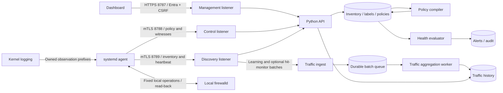

# Prṛthak architecture

This repository is an independent project for host-network inbound microsegmentation on RHEL and Ubuntu. This document describes the current 0.8 implementation; the historical checklist at the end is separate from the [current user requirements](requirements-delivery-map.md).

## Responsibilities

The browser uses the controller API for all inventory, policy, learning, flow, audit and alert operations. The controller is the source of truth for administrator-managed business labels and intended access policies. Endpoint-reported identity does not authorize tag changes. Combined dashboard filters use AND across dimensions and OR within a dimension. Inventory port filters match discovered listeners; historical flow filters match the actual observed port even if that listener is no longer present. KPI drill-downs use the same selected scope.

The topology draws communication edges only from supplied flow observations. Fresh heartbeat status pulses are separate from flow animation; a path animates only with recent observations from a currently collecting, fresh endpoint and matching learning session. Historical paths remain static. The initial canvas bounds the number of visible data centres and hosts and displays the overflow rather than inventing or silently dropping aggregate counts.

A deterministic compiler resolves target selectors and source group membership to each endpoint's effective per-service source list. Only a change in effective access changes the endpoint's access policy version. Learning assignment changes affect the HTTP ETag separately. Policy version and delivery ETag are different concepts.

The Go agent runs under systemd. New GUI kits and fleet settings default to initial service discovery, then a scan every 900 seconds and control/report polling every 30 seconds. Scoped polling overrides and the optional 1–20-host 30/60-second pilot preset are explicit; legacy configuration may retain older intervals. Cached heartbeats preserve the original successful scan timestamp; only a new successful scan changes listener inventory and creates discovery alerts. Trusted executable/process credentials and systemd identity identify SSH on a custom port; a port number or untrusted process name alone does not establish that identity. The agent uses outbound HTTPS and a separate certificate identity per endpoint. It retains local state during controller outages. Optional temporary learning expires locally. Separate continuous hit monitoring starts disabled, generates no access policy and requires refreshed signed leases of at most 120 seconds.

The health evaluator runs independently of HTTP requests. It checks missing heartbeats, previously present listeners, explicit expectations and effective ordinary/learned policy expectations. A changed policy expectation requires a successful fresh scan after the change; withdrawing an expectation does not count as a service recovery. Host-offline or stale/failed discovery suppresses misleading individual service-down conclusions. A listening socket alone does not establish application health or reachability from a particular source.

## Reusable ports and source membership

The Services page stores flat service/port groups with immutable UUIDs and 1–100 distinct exact TCP/UDP pairs. These definitions contain ports only; existing dynamic/static server groups supply source or target membership. Each policy service row chooses either a single port/protocol or a service-group ID. Its explicit CIDRs, matches of one AND tag selector, and members of multiple `source_group_ids` server groups form a union for every port in that row. Distinct rows retain their own source alignment. Overlapping enforce rows union their enforcing sources; monitor rows cannot widen an enforced allowlist. An empty resolved source set allows nobody.

The compiler indexes effective tags and saved group membership once per fleet compilation. Selector results and source-group address sets are cached across policy rows and hosts. Static groups use enrolled explicit members; dynamic groups follow their current central tags/location. Group membership and source-IP changes recompile intended bundles without repeatedly scanning the full fleet for each destination. The 5,000-server design target still requires measured real-agent load validation.

Saving a policy resolves each referenced service group into a `service_group_snapshot` containing its actual ports, revision, ID and name. Client-supplied snapshots have no authority. Global service-group edits require `expected_revision`, reject stale updates and provide a read-only impact preview separating referring policy targets from hosts whose effective rules change. The save transaction records immutable catalogue history, revises active policy snapshots and compiles once. Host versions advance only for effective access changes; metadata-only renames leave access versions unchanged. Historical policies and bundles retain the exact port/revision snapshots used. Restoring an old policy resolves the current saved catalogue and current source membership rather than rolling either back.

Deletion is blocked while an active policy references a service group or uses a server group as a source/target. Unknown service/source-group references abort compilation and preserve previous bundles instead of silently removing enforced ports or broadening selectors. An authorized Admin save compiles and publishes changed exact ordinary per-port intent without a separate checker or rollout step. Current authority, local opt-ins and endpoint protection/health/rollback still gate application. On an existing whole-server default-deny host, a changed deny-bearing bundle instead stays pending until its fresh dedicated downtime acknowledgement; no catalogue or membership edit can bypass that boundary.

## Reusable fleet bootstrap

An Admin generates one fleet setup file, with common trusted URLs/polling and
an expiring/revocable enrollment key. The matching CPU agent package and the
same data-only setup can be distributed to any number of prepared hosts. Each
host generates its own private key and CSR; the controller issues a unique
certificate and inventory identity. No hostname list or per-host package is
required. A shared bootstrap credential never becomes shared endpoint identity.

Profile metadata, hashed credential lookup and canonical-public-key receipts
use separate indexed namespaces. Transactions serialize concurrent enrollment,
retry and revocation across processes/controllers. Active profile and current
endpoint/certificate status are required even before idempotent bootstrap
replay. Profile revocation blocks new enrollment while existing endpoint mTLS
continues. Recovery discards bootstrap authority; used key claims survive.
Individual one-use/15-minute kits remain compatible. See [fleet enrollment](fleet-enrollment.md).

## Fresh per-endpoint automatic learning

The dashboard defaults to automatic discovered ports. An administrator selects explicit endpoint IDs and a bounded duration; the initial preview uses cached inventory and starts no collection. Session creation requires every selected agent to advertise `learning_discovery_v1` (0.3.0 or later), then sends each host a pending discovery assignment. Older agents remain usable with explicit manual ports; the previous dashboard's prefilled 22/80 list is no longer the automatic default.

The running agent performs a fresh scan tied to that session and reports its session ID with the discovery snapshot. The controller accepts only that endpoint's successful snapshot taken at/after session start, freezes its first eligible exact TCP/UDP port set and returns only those ports to that endpoint. The session's display union never becomes a fleet-wide collection scope. Eligible binds are wildcard or known non-loopback addresses. Unknown and loopback-only binds are excluded. Failed scans retain pending/error state and retry while the session is active; offline, no-listener and over-100-port results remain visible without instrumenting unverified ports. Subsequent inventory changes do not expand the frozen set.

Expiry starts when the request is created, including discovery, retry and outage time. A one-hour request therefore does not establish one hour of collected coverage. Ready assignments add owned log-only observation rules; pending/empty assignments add none. Discovery and port freezing change learning delivery/ETag, not normal managed access-policy versions. Optional `port_filter` is intersected with each fresh listener snapshot: `443/tcp` never includes 22, 80 or UDP443, and no match produces an empty frozen scope. Full inventory remains available.

### Evidence and separately authorized learning allowances

`policy_action=observe` is the default. `auto_allow` requires fresh discovery, explicit consent, `learning_auto_allow_v1` and the initiating authorized Admin action. Fresh discovery freezes its exact per-host scope before automatic additions; local opt-ins and management protection remain mandatory. Processed traffic batches transfer exact session/host/source/port/protocol evidence to durable indexed metadata. A metadata receipt commits before the traffic `evidence_processed` marker, making cross-store replay idempotent; raw traffic is pruned only after evidence delivery. Per-host indexed lookups avoid scanning fleet policies on each agent poll. Recommendations and complete CSV exports use durable evidence rather than the bounded dashboard chart query.

Automatic mode derives one learning-owned policy per session/host, retaining exact host CIDRs and each port's source set. Its own per-host generations, history, target/protection bindings and health witness are independent of normal managed approvals. A grant authorizes only its selected exact additive accepts while active; protected management ports, unsupported agents, invalid sources, capacity and incomplete protection block application. Endpoints also require explicit local write options and locally observed ingress evidence for automatic additions. The agent journals and verifies runtime/permanent changes under the shared firewall lock and an independent watchdog. Access overlays are identified separately from observation rules and managed reject rules.

Stopping learning revokes new automatic mutations and preserves committed allows. Explicit review can apply selected evidence to a frozen server/group membership snapshot; manual grants/edits/removal use nonce/digest-bound Admin actions, with two explicit same-actor confirmations for restrictive edits/removal; applied edits suppress regeneration. Cleanup stays visible until an exact endpoint receipt confirms it. Failed mutating auto grants are held across new hits/generations. Read Only can inspect/export; Admin and Super Admin can change learning behavior and review/apply policies. Observations remain sampled evidence, not proof of a completed or trusted application connection.

Whole-server default deny cannot be enabled with active automatic learning or remaining learned grants. Observation may continue, but learned-access and imported-rule mutations are held while whole-server enforcement or its removal remains active.

## Central business metadata

Enrollment creates endpoint identity only. Tokens and the agent configuration do not supply business tags or DC/location: new token requests reject nonempty metadata, and legacy token defaults are ignored. Agent reports carry hostname, addresses and discovered service/process identity. A listener's application name never assigns the host's business `application` tag.

Saved DC/cloud catalogue entries are created manually and have stable IDs with editable names/geography. Every endpoint has one saved location and multiple custom tags. Administrators can assign them individually or through bulk changes to explicit selected endpoint IDs. Bulk preview exposes before/after values before a separate apply. Manual changes pin fields; a removed tag remains removed, and an explicit manual Unassigned location remains unassigned, until reset to automatic. Existing populated assignments migrate as manual overrides.

Exact-IP CSV profiles support current and not-yet-enrolled endpoints. Import validates the whole file and stages a durable preview before nonce-bound apply. Blank cells preserve prior profile values, while manual overrides win. The dashboard lists profiles with current/future/ambiguous binding status and provides reviewed removal; removal recalculates automatic values while retaining manual choices. Hostname is inventory and cannot be overwritten by import.

Subnet mappings attach a CIDR to an existing saved location. They apply to current eligible endpoints and future address reports. The longest matching prefix wins per address (/24 over /16 over /8), while exact normalized CIDRs cannot be duplicated and /0 is refused. If addresses on one endpoint resolve to different DCs, the controller records a conflict and leaves the automatic location unresolved. Different CSV values across an endpoint's addresses and duplicate reported ownership also remain visible conflicts.

Effective per-field precedence is **manual override → exact-IP CSV profile → subnet location → unassigned**. Subnets supply location only; a tag without a manual/CSV value is absent. Metadata sources, persistent removals and conflicts are returned with server inventory. The controller recalculates automatic assignments from address reports without accepting agent-supplied business labels. Bulk/CSV/subnet/profile-deletion plans use shared-store transactions and reviewed-state fingerprints so another HA node can apply the same valid plan; relevant intervening changes require another review.

Effective central assignments drive dynamic application/custom groups and policy source/target membership. Only a changed access result advances the endpoint's policy version. An authorized metadata Save recalculates and publishes changed exact ordinary per-port intent. Changed whole-server default-deny bundles require a fresh dedicated review; future matching group members are not silently enabled. Endpoint local opt-ins, signature/scope/protection checks, health and rollback still determine whether intent is applied.

## Data paths

The initial development controller uses SQLite for inventory and a separate SQLite database for the durable traffic queue/history. Accepted batches are durable before acknowledgement, and processing is idempotent. This makes the complete path runnable without external services; it is not evidence of readiness for a production fleet of thousands.

An optional PostgreSQL backend supports multiple active controller nodes with shared inventory and separate traffic persistence. Database advisory transaction locks guard read/modify/write operations across nodes; session locks coordinate health and traffic jobs and release when a worker disconnects. Batch/event uniqueness keeps traffic replay idempotent. Readiness checks both writable shared dependencies, and a shared registry exposes node/site heartbeats and stale nodes. HA configuration requires both database DSNs and never falls back to a local database. See [HA deployment and recovery](ha.md).

The installed serving path uses bounded Gunicorn HTTPS, configurable worker/thread limits and bounded durable traffic ingestion. Post-fork PostgreSQL pools reuse exclusive sockets with a bounded lifetime; each borrow starts a fresh transaction and checks the namespace/deployment epoch. JSON read/modify/write transactions remain serialized within each storage namespace. Public catalogue/history/session navigation uses bounded projections and lazy exact details rather than loading every authority matrix. For thousands of endpoints, size storage from measured event rates/retention and validate the actual hardware, replication and WAN workload. Certificate lifecycle, direct authorized-Entra-Admin publication, signed assignments/releases, reviewed notifications and supervised recovery are implemented. Actual tenant/provider acceptance, native DB watchdog/fencing and physical site/WAN failure remain external gates. See [current capacity evidence](controller-capacity-5000.md) and [0.8 release evidence](release-0.8.0-pilot.1.md).

## Observation and enforcement

A policy identifies target servers, exact ports (directly or through a saved service group) and allowed sources; destination is implicit in the target server. Source CIDRs, resolved source labels and selected server-group members are unioned within their row. A monitor-only policy must not broaden a port under enforcement. An empty source list means allow nobody, not allow everybody.

Observation records connection attempts visible to the collector. These are not application requests or proven successful connections. Flow records include actual collection windows and event loss; counts must not be described as exact if collection was rate limited or interrupted. The last-hour filter is a query window, not a guarantee that the preceding hour was fully collected.

Observe mode creates no access policy. Explicit Admin-enabled automatic mode may create exact-source additive policies inside its fresh frozen scope. A short quiet window does not prove a dependency is unnecessary. Operators review learned sources against a representative application cycle.

The agent starts in preview mode. A compiled policy, its preview plan, a successful apply acknowledgement and observed effective firewalld state are separate facts. Unsupported enforcement must return an explicit error rather than claim that a version was applied. Changes to live Linux firewall configuration require a tested adapter and rollback path; a build on macOS does not validate those effects.

### Optional whole-server inbound default deny

Whole-server default deny starts disabled and uses a dedicated review, not an ordinary policy toggle. The review freezes exact enrolled endpoints/group membership, enforce-only grants, configuration receipt and protected network context. A current Admin must manually tick the initially unchecked downtime acknowledgement before each push. Reviews expire after ten minutes; changed hosts, sources, versions, configuration or protection require a fresh review. There is no second-person requirement. Each endpoint also needs `host_default_deny_v1`, signed assignments and local `allow_host_default_deny:true` with managed enforcement enabled.

The agent stages an owned IPv4/IPv6 host INPUT **REJECT** fallback after approved grants and declared control exceptions. It applies to new inbound connections; established/related sessions and loopback handling remain, with no conntrack flush. The `host-inbound-control-v1` profile preserves source-restricted actual SSH ports, ICMP/ICMPv6 and DHCP-client UDP 68/546. Live endpoint preflight rechecks the native context; unsupported NAT/routing/foreign-rule/zone contexts block application. This is not egress or container/forwarded enforcement.

Later allowlist/source/tag/group changes compile desired intent but hold the last working firewall until a fresh acknowledgement. Disable removes only the global fallback using the last authenticated applied ordinary grant matrix, without folding pending edits into removal. Normal compilation resumes after a matching successful removal receipt. Turning off the local opt-in alone does not remove committed rules. Status distinguishes never enabled, pending/review required, enforced, removal pending, disabled, rolled back and error; the last authenticated receipt is not a live kernel probe. See [workflow](whole-server-default-deny.md) and [exact API](api-contract.md#whole-server-inbound-default-deny).

## Firewall ownership and platform support

The first scope is host-network TCP/UDP services on RHEL and Ubuntu. Containers, Kubernetes, forwarded traffic, NAT source identity and application-layer checks require additional design and test coverage.

Enrollment reports OS release, firewall backend/version and active firewall manager. UFW is detected and reported; the installer never silently disables it. Migration must preserve existing rules and management access. The agent cannot prevent local root or other privileged firewall writers from making changes, so the platform detects drift rather than promising exclusive ownership.

Labels such as `network_zone=production` are application metadata and remain distinct from firewalld's own zones.

Approved `application` tags also create reusable dynamic application groups. An existing exact saved application group retains its identity and editability; missing application groups are created with stable IDs and protected tag-driven membership. Custom/static groups remain separate. Agent-reported process/application names do not assign business application tags or groups. A server's saved location remains an independent field resolved from central manual/CSV/subnet assignments.

## Historical readiness checklist - 31 October 2026 (0.6 lab)

This retained engineering checklist came from the earlier G1–G32 assessment, rather than the user's current requirement register. Its proposed extensions are not silently promoted to requested features or release blockers. Later delivered features are noted where they supersede a row; the [current delivery map](requirements-delivery-map.md), [0.7 remediation record](review-remediation-0.7.md) and [0.8 release record](release-0.8.0-pilot.1.md) govern current behavior and evidence. No test or implemented safeguard certifies a platform or starts a pilot.

The actual controller is Python with optional shared PostgreSQL, and the dashboard is plain JavaScript. Traffic learning uses sampled rich-rule logging and kernel-journal reads. A Go controller, React/TypeScript, TimescaleDB, conntrack and NFLOG are proposed choices, not implemented capabilities. Framework migration is not itself a microsegmentation security requirement.

Full arbitrary existing-ipset definition/membership import remains outside the inventory adapter. Approved source membership resolves to exact CIDRs; capable 0.6 endpoints can apply bounded managed and additive learning banks after separate reviewed empty-bank preparation. Policy application fills/read-backs inactive banks and does not reload firewalld. Application-defined source groups and reported host IPs must not be confused with authenticated packet/workload identity.

### Checklist coverage

| ID | Capability | Current status and remaining work |
| --- | --- | --- |
| G1 | Protected management access | Lab implementation: actual SSH ports and pinned management CIDRs, fresh source-bound SSH and controller mTLS health. Broader supporting-dependency baselines and every management vantage still need validation. |
| G2 | Break-glass | Missing: audited local recovery command, source-restricted rescue policy, expiry and reconciliation. A permissive allow-all reset should not be the default. |
| G3 | Safe apply | Implemented for supported lab contexts: durable journal, runtime-first staging, fresh health, independent systemd rollback/fencing, read-back and gated permanent commit. Full platform/failure matrix remains. |
| G4 | Staged rollout | Missing: canary/batches, failure thresholds, automatic halt and cohort rollback. |
| G5 | Change windows | Missing: scheduled, timezone-aware maintenance windows and exception handling. |
| G6 | What-if | Missing: configuration diffs exist, but learned-dependency impact simulation does not. |
| G7 | Version history and rollback | Lab implementation: immutable policy/bundle histories, separate outcomes, comparison and restore-as-new-revision/version with fresh review. Tamper-evident audit remains production work. |
| G8 | Monitor to enforce | Implemented direct authorized-Admin publication, local opt-in, protected enforcement and owned-rule cleanup. Automated canary/cohort orchestration remains outside this adapter. |
| G9 | Drift resolution | Partial: snapshot conflicts and version/apply-error signals exist. Effective-rule reconciliation and approved alert/adopt/restore choices are missing. |
| G10 | Controller outage behavior | Supported lab scope verified: committed rules persist, in-progress health failure rolls back, failed approvals stay held across restart; no outage-triggered allow-all. |
| G11 | Service catalog | Versioned exact TCP/UDP service/port groups and process/unit discovery exist. An editable approved process-signature override catalog is separate. |
| G12 | Unknown services | Partial: unknown identity and new-service events exist. Dedicated rogue-service classification, ownership and severity policy are missing. |
| G13 | Dynamic-port noise | Partial: TCP discovery is listener-based. UDP ephemeral bindings, RPC/dynamic service ranges and approved exceptions need explicit treatment. |
| G14 | IPv6 | Partial: address/CIDR parsing and observation families exist. Full dual-stack enforcement and management/reload/failure validation are incomplete. |
| G15 | Container hosts | Missing explicit support/coverage reporting: Docker/Kubernetes/namespace/forwarding ownership and bypass detection need a support matrix. Conservative write refusals are not container support. |
| G16 | Egress | Missing: outbound visibility and enforcement. Agree whether required for the first production scope. |
| G17 | Retention | Partial: configurable hours with 24-hour default. No tiered raw/hourly/daily retention or measured long-term storage plan. |
| G18 | Topology | Substantially present: DC/cloud groups, real observed links, filters and drilldowns. Richer application/zone hierarchy is an enhancement. |
| G19 | Evidence reports | Complete durable learning-pair CSV and scoped reviews are implemented. Formal effective-access/unused-rule/auditor assurance needs coverage and independent deployment evidence. |
| G20 | Rule hygiene | Partial: exact common rules and broad-risk flags exist. Semantic overlap/shadow analysis and coverage-qualified unused-rule findings are absent. |
| G21 | Notifications | Implemented reviewed Slack/HTTPS webhook/TLS SMTP, encrypted secrets, durable occurrence outbox/backoff/idempotency and ambiguous-ACK handling. Actual destination/provider and specialized SIEM acceptance remain. |
| G22 | Alert lifecycle | Partial: open/acknowledged/resolved, recovery and deduplication exist. Ownership, suppression, escalation and resolution reasons are missing. |
| G23 | Lateral-movement scoring | Updated since the assessment: bounded same-source/port/protocol cross-host correlation and opt-in closed-port observations generate possible-activity alerts. They are not proof of compromise or a complete listening-service denied-source ledger. Additional scoring/zone enrichment is separate. |
| G24 | Threat intelligence | Missing, optional: a later integration rather than the first enforcement release gate. |
| G25 | ITSM | Missing, optional: tickets and approved change-ticket binding. |
| G26 | HA | Shared PG/readiness, three-node PG 16/Patroni/etcd, replication rotation and internal leaf/restore helpers passed isolated checks. Native watchdog, physical WAN/site loss and redundant ingress remain external acceptance. |
| G27 | Backup/DR | GUI private database archives/schedules/retention and supervised recovery exist. One current Super Admin completes two explicit same-actor confirmations; no second person is required. Real HTTPS SQLite/crash-resume, PG coordinator barriers and three-node restore helpers were separate fixtures. Missing live safety context blocks online recovery; physical DR/RPO/RTO/PITR and off-node protected copies need explicit deployment procedures. |
| G28 | Agent upgrades | Linux amd64/arm64 archives, dedicated Ed25519 release signatures and independent pre-extraction verification exist. Signed RPM/DEB repositories and automated staged fleet upgrades are not supplied. |
| G29 | Decommissioning | Reviewed server retirement, certificate registry revocation and endpoint recovery exist with cleanup blockers/history. Internal suspension is not full revocation of copied CA/DB authority; complete compromised-controller decommission requires fenced offline CA/all-secret recovery. Address ownership remains an endpoint claim. |
| G30 | Time synchronization | Missing: NTP/skew reporting and alerts. Timestamp validation alone does not provide this. |
| G31 | Resource limits | Partial: systemd hardening and bounded spools/batching exist. A small passive Linux-container baseline is measured ([scope](agent-resources.md)); target-host/learning/enforcement/endurance profiles, CPU/memory hard limits and compressed uploads remain absent. |
| G32 | Fleet scale | 5,000 virtual mTLS identities with signed policy/report/learning workload measured on local PG; bounded serving/ingestion and separate GUI pagination work exist. Real Linux/WAN/quorum/enrollment/soak/incident-burst capacity is unproven. |

### Production release gates

1. **Actual managed enforcement and effective-state validation.** Validate the defined per-port and optional whole-server scope, precedence, source unions, empty groups, IPv4/IPv6, named-service changes, unmanaged broad allows, ipsets/policies/direct rules and established-connection behavior on the selected native platforms. A successful command or listening socket is not proof of remote reachability or application health.
2. **Safe recovery and fleet rollout.** Preserve narrowly scoped management dependencies, provide expiring local rescue, verify connectivity before permanent persistence, and use an independent rollback deadline. Canary one approved host before batches, halt on failures and define cohort recovery. A snapshot-bound diff and local inverse journal already exist; they cover a narrower failure class.
3. **Named identity and Admin authority acceptance.** Exercise direct authorized-Admin Save/Apply with the organization's live tenant/MFA, revoked sessions and changed roles. Verify the same actor's explicit two-step confirmations for deny/restrictive imported changes, restrictive learned changes/removal and destructive Super Admin recovery, and the separate per-push downtime acknowledgement for whole-server default deny. Exactly three global roles are supplied; tag-scoped administrative RBAC is not. Metadata/source changes publish ordinary per-port intent directly and hold changed whole-server bundles for fresh acknowledgement. Shared tokens remain lab-only.
4. **Credential and policy authority acceptance.** Exercise implemented endpoint/internal-leaf renewal, exact revocation/recovery, independently pinned signed assignments/releases and supervised restore. Prefer the offline artifact provider when the signing authority must be isolated from a compromised API process. A separate online seed accessible to that process is not that isolation. Compromised-CA recovery and authoritative address ownership require separate procedures.
5. **Trustworthy evidence and operations.** Use identity-attributed, tamper-evident audit with before/after, ticket and outcome context; acceptance of implemented external delivery and signatures; governed service/tag lifecycle, clock monitoring, SBOM/vulnerability review and measured runtime resources.
6. **Measured platform and recovery evidence.** Test real RHEL 8/9 and the intended Ubuntu versions (including native 26.04) with systemd/SELinux/polkit/firewalld combinations, dual-stack traffic, reload/reboot, time skew, disk/log pressure, local writers, controller/DB outages and site partitions. Restore metadata, traffic, credential state and agent epochs coherently. Existing container and local HA tests provide useful but limited evidence.

### Important scope and accuracy decisions

- Add **Explain access**: source/group → endpoint/service → allowed, blocked or unknown, with rule/evidence freshness and intended-versus-observed state. Host policy alone cannot establish router/cloud-security-group/NAT reachability.
- Treat reported IPs as claims by an authenticated endpoint, not authoritative address ownership. A compromised host can currently lie about its IP list and influence source-group resolution. Address approval, DHCP/cloud reuse, overlapping DC/private networks, NAT and cloned identities need explicit handling.
- Keep coverage visible. Temporary or sampled learning cannot establish that a zero-hit rule was unused for 30 days. The current probe monitor does not cover every denied source hitting an already listening service, and a possible scan is not proof of compromise.
- Move production filtering and pagination into authorized server queries. Current global 500-row traffic/audit bounds can omit matching records before a user filters them; an empty local result is not estate-wide absence. Return totals, limits, coverage and truncation explicitly.
- Select runtime privileges from tested D-Bus/process/journal requirements. Do not add `CAP_NET_RAW` merely because it appears in a template. Fixed validated argument vectors without a shell are not arbitrary remote-command execution; switching to D-Bus does not replace validation.

This ordering follows the distinction between policy decisions and actual enforcement in [NIST SP 800-207](https://nvlpubs.nist.gov/nistpubs/specialpublications/NIST.SP.800-207.pdf), and the phased planning approach in [CISA's microsegmentation guidance](https://www.cisa.gov/sites/default/files/2025-07/ZT-Microsegmentation-Guidance-Part-One_508c.pdf). It is an engineering readiness assessment, not a regulatory compliance certification.
