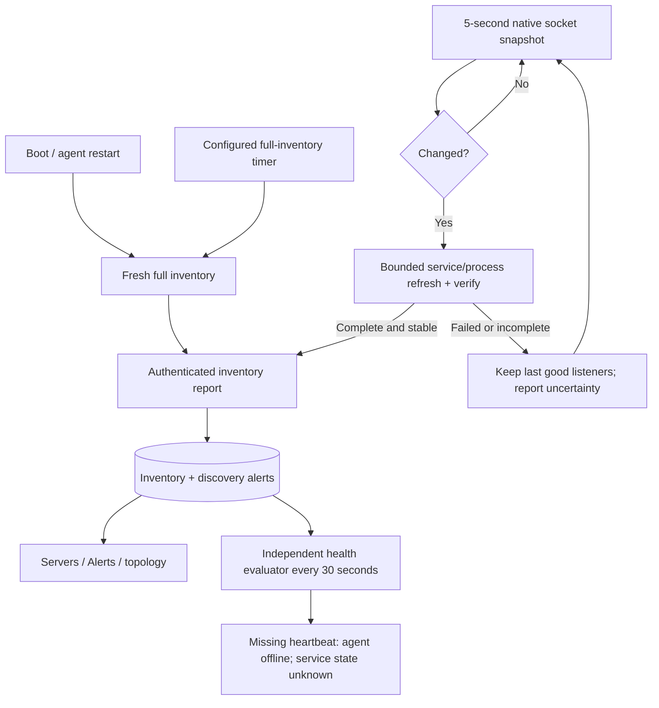

# Endpoint discovery, preparation and health

This describes the 0.11 endpoint changes. Native RHEL 8/9 and Ubuntu 26.04
acceptance, SELinux/polkit checks, real package hooks and DC deployment remain
deferred. Mocked package commands and isolated Linux sockets do not replace
those checks.

## One policy across supported Linux endpoints

An administrator selects servers/groups/tags, TCP/UDP ports and allowed sources.
There is no OS selection in a policy. The agent reports the actual hostname,
interface addresses, OS/version, firewalld version/backend, service state and
listening services. The controller compiles the same policy model for those
targets; the local agent validates its supported firewalld context before
applying anything. Unsupported or conflicting contexts report a blocked/error
outcome. Other firewall managers are not silently treated as firewalld adapters.

Business tags and the single DC assignment remain dashboard-owned. Discovery
does not overwrite them. The agent-reported interface addresses remain inventory
addresses even when controller traffic crosses an LB/SNAT.

## Startup, restart and service changes

Every agent process starts with fresh full discovery. A machine reboot or
`seg-agent.service` restart therefore refreshes OS/version, addresses,
firewall facts and services on the first successful report. The existing
enrolled identity and locally retained working policy survive the restart.
During a controller outage, reports retry; the dashboard cannot receive the
changed facts until connectivity returns.

The native Linux daemon also compares bounded `NETLINK_SOCK_DIAG` snapshots
every **5 seconds** for IPv4/IPv6 TCP listeners and unconnected bound UDP
sockets. A changed snapshot triggers process/systemd service identification and
an immediate inventory report. Normal idle-loop detection is approximately
**5–10 seconds**, plus network/controller/dashboard delay; blocking loop work
can extend it. This is snapshot polling, not a guaranteed kernel event stream.

Unchanged checks start no `ss`/`systemctl` process and send no extra report.
Each kernel snapshot is limited to one second, 4 MiB and 8,192 records. A
changed snapshot gets a bounded refresh and a verification snapshot. Incomplete,
interrupted, oversized or unstable scans preserve the previous listener list;
they cannot establish that a service disappeared. Unsupported kernels fall
back to full discovery. Simulation and `--once` do not run a background checker.

Full OS/interface/firewalld inventory retains its separately scheduled
**900-second** default, configurable through the GUI. Fast listener scans do
not refresh firewalld snapshot timestamps or postpone that full scan. The
Servers detail drawer shows full-scan fallback, last listener inventory,
freshness deadline and the last reported fast-check state/error.

## Nonresponding agents

Health evaluation runs independently of learning and incoming requests. An
endpoint becomes offline after **max(180 seconds, three control intervals)**
without an accepted report, followed by the next evaluator pass (normally
within 30 seconds). The default 30-second control interval therefore uses a
three-minute threshold. Dashboard auto-refresh adds its own display delay.

An outage raises one active critical `agent_offline` alert, marks the server
offline and treats service health as unknown. Repeated evaluator passes do not
create duplicate outage alerts. A resumed valid heartbeat resolves the outage
and records recovery. An offline agent alone does not prove an application is
down. Historical listener rows remain visible as last observed data. Alerts use bounded pages with exact filtered totals, so more than 500 newer historical events cannot hide a still-unresolved outage. Use the recovered/resolved toggle to browse history.

## Optional OS preparation in the same installer flow

Both **Install missing OS dependencies** and **Assess/export UFW for migration**
start unchecked in the GUI. Selecting either produces a strict schema-3
private setup file; unchanged individual/fleet setups retain schema 1/2.
Reuse the same fleet file and matching CPU package across your intended hosts.
No per-host agent generation or manual `.env`/agent JSON editing is required.

The family wrapper validates the private setup, expiry, hostname binding when
present, trusted CA material and signed binary/systemd unit before invoking the
signed host-preparation helper. Enrollment-key revocation and actual controller
reachability are checked during authenticated bootstrap, not claimed as offline
validation before package operations.

With explicit dependency consent, the helper installs missing `iproute` or
`iproute2`, `firewalld`, `util-linux` and `ca-certificates` through the native
approved OS repositories. Native systemd tools must already exist. RHEL needs
working repository/subscription access. It takes the existing configuration
lease and checks unfinished firewall transactions before package work.

Temporary startup suppression is journaled before package hooks execute; the
helper restores its owned startup metadata and verifies the original firewalld
activity. Existing administrator overrides that cannot be safely preserved
block automatic preparation. UFW is preserved; the helper never starts
firewalld or disables UFW. Partial package installation is reported as such;
it is not presented as a successful package rollback. An interrupted/uncertain
command retains its suppression journal for inspection before another attempt.

If requested and UFW exists, bounded configuration/status evidence is saved
privately on the endpoint at
`/var/lib/seg-agent/host-preparation/ufw-export.json`, mode 0600 inside a 0700
directory. Raw rule contents are not uploaded in inventory reports. The
dashboard receives only a bounded preparation receipt, assessment outcome,
known service activity and the fixed local export reference. Unknown activity
remains unknown. Active/uncertain UFW requires a separately reviewed migration
before firewalld enforcement; this release does not perform that cutover.

Read-only `--check-only`, staging `--root ... --no-start`, and `--no-start`
do not invoke package preparation. Normal installation still starts in
monitor-only mode; installing dependencies never enables policy enforcement.

## Resource evidence

An isolated Linux ARM64 microbenchmark with very few listeners measured about
**1.17 ms and 66.6 KB allocated per complete kernel snapshot** (24 allocations).
This is per-scan allocation, not resident memory or a whole-agent CPU guarantee.
Five-second polling, repeated listener churn and active collection need fresh
CPU/RAM/endurance measurement on the pilot hosts. Historical passive agent
measurements and starting controller VM allocations remain labelled separately
in [the pilot guide](pilot-gui-installation.md#expected-cpu-ram-and-storage).

Created by Pratik Srivastava
