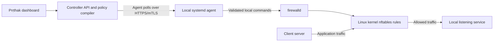

# How Prṛthak enforces microsegmentation

Recommended deployment for the current RHEL/Ubuntu host-ingress adapter:

The controller distributes intended policy and records outcomes. The agent alone
changes endpoint rules. The kernel enforces packets locally; application traffic
does not traverse the dashboard, controller API or agent process. Controller
availability therefore does not add a network hop to application connections.

Use firewalld's nftables backend for this implementation. It is the default
upstream backend, and the iptables backend is deprecated. Direct nftables is a
possible future alternative adapter, requiring its own ownership, transaction,
drift, persistence and rollback design. It is not another toggle in the current
agent. [firewalld configuration](https://firewalld.org/documentation/man-pages/firewalld.conf.html),
[Red Hat firewall guidance](https://docs.redhat.com/en/documentation/red_hat_enterprise_linux/9/htmlsingle/configuring_firewalls_and_packet_filters/index).

Use one deliberately coordinated rule-management path for the endpoint. Do not
add ad hoc iptables/nft flush scripts alongside Prṛthak-managed firewalld rules.
Different managers can coexist in some configurations, but their chain priorities
and ownership must be engineered explicitly. Source sets here use firewalld's
native IPSet abstraction; this does not require invoking the deprecated ipset
command-line utility as a parallel manager.

Ubuntu's usual firewall configuration tool is UFW. Review its existing rules and
management access before a planned migration to firewalld; the stock Prṛthak
installer does not silently migrate or discard them.
[Ubuntu firewall documentation](https://ubuntu.com/server/docs/how-to/security/firewalls/).

## What the current adapter blocks

A reviewed managed policy for TCP 443 can permit only its approved source CIDRs
or resolved source groups, then reject other sources to TCP 443 on that endpoint.
An SSH policy can independently allow only the verified bastion/management
networks on the actual SSH port, including 2022. Both IPv4 and IPv6 require the
corresponding exact source scope. Rich rules support source, port, logging and
accept/reject/drop actions. [firewalld rich language](https://firewalld.org/documentation/man-pages/firewalld.richlanguage.html).

Ordinary policies restrict **selected managed inbound TCP/UDP ports** and
preserve unrelated ports. Adding a managed 443 policy alone does not close 80.
The separate **whole-server default-deny** workflow can reject unmatched new
inbound traffic after the exact approved grants and declared network-control
exceptions. It requires an upgraded agent, a separate local opt-in and a fresh
manually checked downtime acknowledgement for each push. Existing conntrack
sessions are not forcibly terminated. See [the GUI workflow and safety
boundaries](whole-server-default-deny.md).

Temporary learning is separate: observation rules log only; explicitly approved
automatic learning adds accept-only source overlays. That overlay alone does not
reject unobserved clients if a broader existing zone rule still allows them.
Use the reviewed managed policy path for exclusive source restrictions.

Whole-server default deny uses host INPUT rules and retains its explicit
SSH/controller, ICMP/IPv6 and DHCP-client protection. Unsupported NAT/routing,
ambiguous zone and competing-rule contexts block activation. Outbound and
container/forwarded segmentation remain outside this adapter. Discovering no
listener does not authorize closing a port; the dedicated reviewed push does.

## Availability and operating sequence

1. Enroll in preview/monitor mode and verify reported identity, service ports and
   centrally assigned metadata.
2. Learn only the required ports for a bounded period. Review source quality;
   observations include unwanted clients as well as legitimate ones.
3. Prepare the exact group/port/source intent and inspect its affected endpoints.
   An authorized Admin applies the intended scope directly; retain endpoint opt-ins, exact bindings, protection, health and rollback checks.
4. Verify reachability, read-back, rollback and drift before expanding.

A controller outage preserves already committed endpoint rules. Stopping
firewalld is a different event: upstream `CleanupOnExit` defaults to true and
removes its rules on stop. Keep the service enabled and monitor its status; do
not infer active enforcement solely from a retained controller policy. Prṛthak
raises a critical availability alert when a reporting endpoint says firewalld
cannot be verified running. It records that kernel rule state is unverified,
and resolves the occurrence only after a nonstale report says running/active.
The observation follows the agent's reporting/discovery cadence; it is not a
continuous independent kernel probe. A missing heartbeat raises an agent-offline
event instead. [firewalld service-exit behavior](https://firewalld.org/documentation/man-pages/firewalld.conf.html).

DC deployment/native operating-system and management-path acceptance are handled
by the operator. No infrastructure-host enforcement is approved by this document:
controller, database and LB ingress protection still requires topology-specific
validation.

Created by Pratik Srivastava
