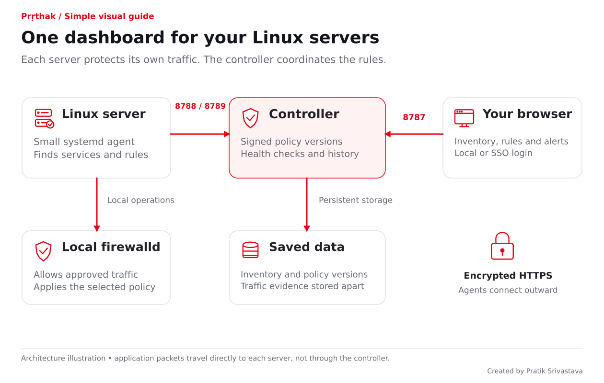
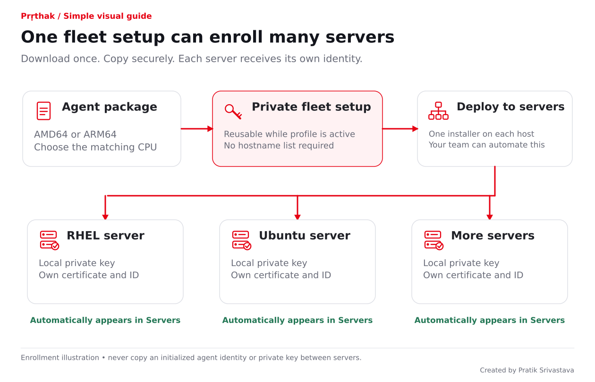
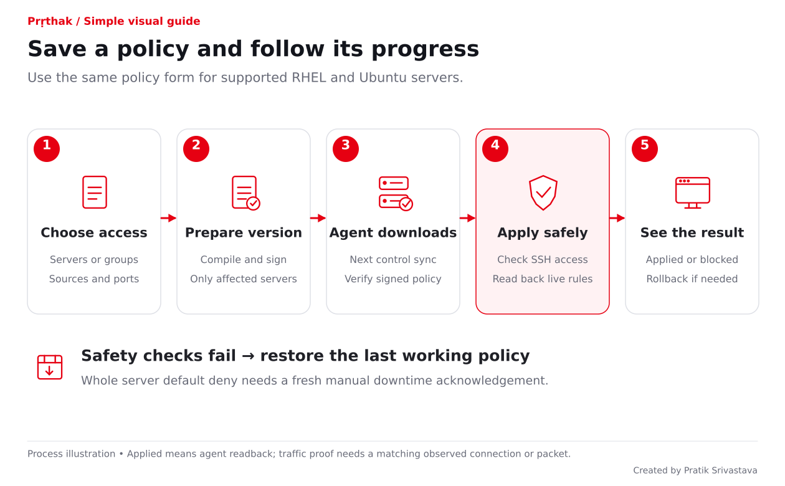
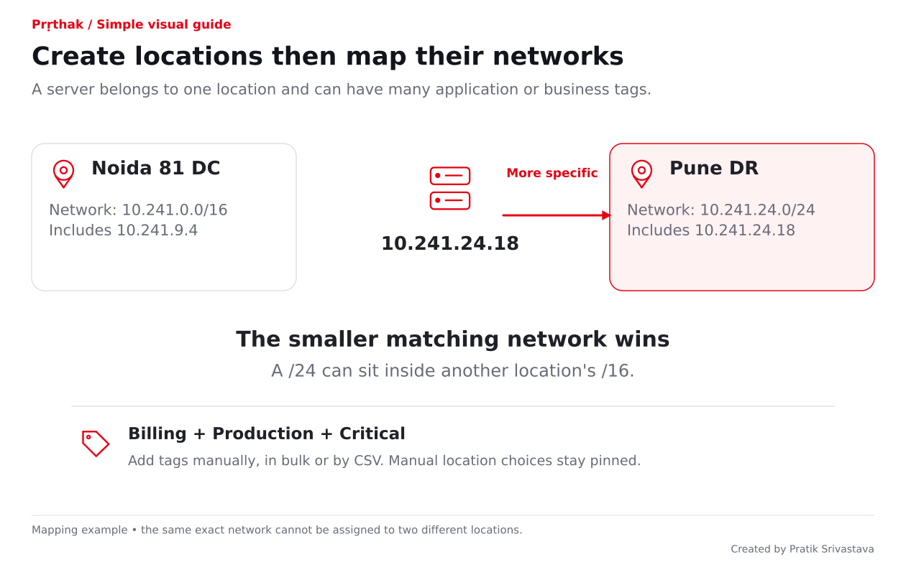
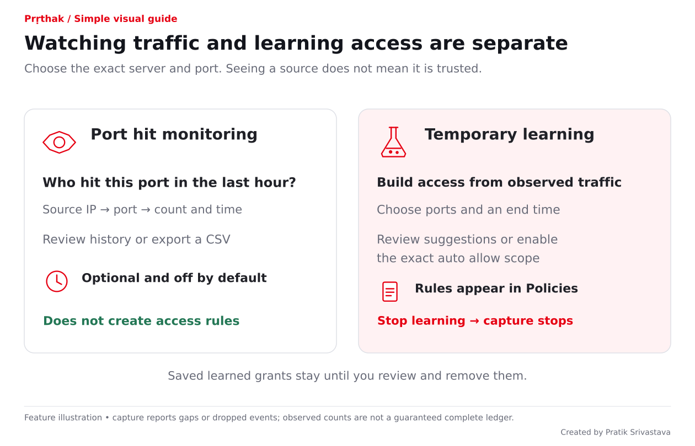
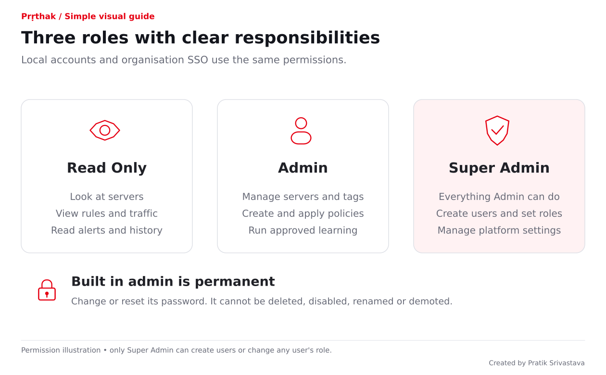
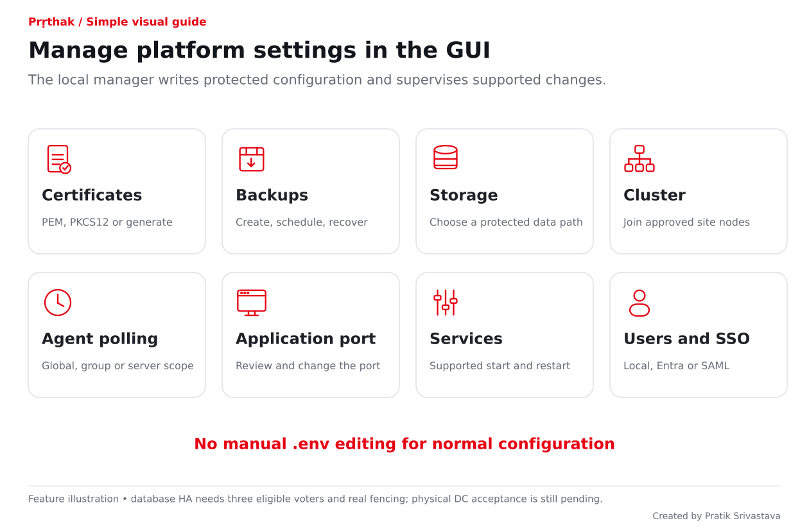

# Prṛthak features in simple language

**One place to see your Linux servers and control who may connect to their services.**

This explains what you asked for and how Prṛthak does it. The current implementation is **0.18.25**. Use the [current commands and support profiles](installation-commands.md). For the illustrated flow, start with the [controller picture guide](guide/simple/controller-installation.html), then follow the [agent picture guide](guide/simple/agent-installation.html).

## The controller is the control room

- **Dashboard:** the screens you use to see servers and make changes.
- **Controller:** checks permissions, prepares policies, stores records and raises alerts.
- **Agent:** a small background service on each Linux server. It discovers services and makes approved local firewall changes.
- **firewalld:** the server's firewall manager. Linux filters the actual application traffic; Prṛthak does not carry that traffic.

The browser uses HTTPS **8787**. Agents connect outward to **8788** for policy/control and **8789** for enrollment/reports. An agent needs no inbound management port. Your network team can use approved load-balancer addresses instead of direct controller addresses.

## Install once and let servers appear

**What you asked:** one agent you can install on 20 servers now and more later.

Download **one fleet setup file** from the GUI and reuse it with the matching CPU package. The same installer detects RHEL or Ubuntu automatically. Each server creates its own private identity and appears after its first successful report. There is no fixed enrollment-count limit and no need to generate 20 individual agents. Fleet setup files expire and can be revoked.

**New agents start in monitor-only mode.** They do not change firewall access until the reviewed endpoint configuration explicitly enables enforcement. Later security opt-ins use a GUI-generated signed setup and a local apply step; an ordinary policy save cannot enable them silently.

The agent reports hostname, actual interface IPs, Linux version, firewall information and listening services. SSH on **2022** can be identified as SSH from its process, rather than guessed from port 22. Booting or restarting the agent refreshes this information. Business tags and DC names come from your dashboard.

**You configure the product in the GUI.** Run `sudo ./scripts/install-controller.sh` for a RHEL 9/10 or Ubuntu 26.04 controller. It prepares missing protected Python, Docker Engine and Compose dependencies before opening GUI setup. Run `sudo ./scripts/install-agent-auto.sh --setup-file /root/prthak-agent-setup.json` on RHEL 8/9/10, Rocky Linux, AlmaLinux and Oracle Linux 8/9, plus Ubuntu 22.04/24.04/26.04 endpoints. It validates the GUI kit and signed runtime, detects the OS and prepares required packages automatically. The server team provides genuine systemd, root/sudo access, approved repositories/network paths, storage and verified root-owned release files. Conflicting container stacks block controller installation without removal. Existing Ubuntu UFW and firewalld activity are preserved; optional UFW assessment starts off, and an approved firewall cutover is separate.

## Write one policy for a whole application

**Example:** “All Billing servers allow these approved sources on 443 and 8443.”

Select individual servers, a group, or matching tags. Choose saved service groups or individual TCP/UDP ports. Each rule row has its own allowed sources: IP addresses, networks, tagged servers or groups. The selected server is already the destination, so you do not enter a destination address again.

The form stays the same for RHEL and Ubuntu. The controller prepares each server's assignment; the local agent checks its actual firewalld capabilities. Unsupported configurations are shown as blocked instead of guessed. Identical permissions are combined, and an identical rule already present is read back and skipped.

An authorized **Admin** saves an ordinary change directly. Agents collect it automatically on their next successful control poll. Enforcement-enabled agents verify its signature, apply it safely and report the outcome. There is no second-person approval requirement. **Persistent push notifications are a possible future improvement; current delivery uses periodic polling.**

For the 60-second delivery target, use **30-second control polling** through the GUI. Timing includes extra work and network delay; this is not a promise that every firewall changes at exactly 30 seconds.

## Keep access safe while changing rules

The agent checks protected SSH/controller access, records the previous state and verifies the result. A failed safety check triggers rollback or a visible recovery problem. Policy versions and history show what changed. A controller outage keeps the last successfully applied policy on the endpoint.

**Whole-server default deny** is a separate GUI action: allow the approved sources/ports and reject the remaining new inbound connections. It starts disabled. The Admin must review the exact selected servers and manually tick the downtime acknowledgement before each changed default-deny bundle is applied. New group members do not silently inherit activation. Existing protected access and rollback checks still apply.

The top-right **Rollouts** panel distinguishes installed rules from observed traffic. “Applied” means the agent checked the rule state. “Traffic verified” needs the required real allow/deny observations for each applicable port and server. No traffic means waiting/unverified, never an invented pass. A successful observation does not prove every application dependency.

## Put every server in the right place

Create your DC/cloud locations and names first. Assign them manually, use exact-IP CSV imports, or map networks to locations. A server has **one DC/location and many tags**, such as Billing, Production and High criticality.

**Example:** map `10.241.0.0/16` to Noida and a smaller `10.241.24.0/24` to Pune. The smaller matching network wins. A manual assignment takes priority, then an exact-IP CSV assignment, then the most specific subnet. The same exact network cannot belong to two locations; conflicting reported-IP/DC claims are held for review.

Open **Tags & groups** to create and list tags. In a single-server or bulk assignment form, search and tick saved tags; you do not need to type them again. A server can have several tags, with one value per tag key, and one separate DC/location. Existing assigned tags and CSV-profile tags are retained in the catalogue.

Choose **Create Server Group** for selected servers or a dynamic group that follows matching tags. **Server Groups** shows how many groups exist and each group’s member count. **View servers** opens the member hostnames, full reported IP addresses, location and health. Static groups contain chosen servers; dynamic groups follow matching tags. Combine filters such as **Billing + Noida + port 443**, and click overview counts to open the matching records. The **Tags** filter has searchable saved choices; no custom-tag text is required. Discovered services are listed in alphabetical order.

## Watch traffic or learn new access

| Your choice | What happens |
|---|---|
| Monitor a port | Show sources, port, protocol, counts and first/last seen; last hour is the starting view. No access is granted. |
| Learn temporarily | Collect observations for selected servers and ports; review suggestions and export CSV. Capture stops when the session ends. |
| Learn and automatically allow | The initiating Admin authorizes an exact scope. Eligible observed sources can be added to that port's visible learned policies automatically until expiry. |

**Example:** learn only **443** while leaving **22 and 80** outside the session. Monitoring is optional and disabled by default; its retained window is 1–24 hours. Protected management ports are excluded from automatic learned access. Observing a source does not make it trustworthy.

New capture uses **conntrack** for accepted connection observations and verified **NFLOG** for denied packets. Older firewalld builds can negotiate scoped, rate-limited **Deny log (sampled)** collection with an upgraded agent/controller. Those are log records, not native packet proof. The Traffic page keeps its latest 20 sessions behind **Session history**; policy-discovery progress stays on Policies. These have different count units and can have coverage gaps. The dashboard shows those limits; it is not a complete packet recorder. Older journal-based history remains labelled as older evidence.

## See changes and problems quickly

Separate pages cover Overview, Servers, Locations, Services, Firewall, Policies, Traffic, Alerts, Activity and Settings. The DC/cloud picture shows server health, observed communication lines and recent events. Motion can be paused.

- New or stopped services produce alerts from fresh, complete discovery. Native fast listener checks run every **5 seconds**; detection is normally about **5–10 seconds plus reporting delay**. Full OS/firewall discovery normally runs every **15 minutes**. Failed scans keep the last good data and show uncertainty.
- A missing agent raises an offline alert after **three minutes or three control intervals, whichever is longer**, plus evaluator/display delay. Recovery is recorded. Offline does not by itself prove the application is down.
- Optional closed-port monitoring can flag probing and possible movement across several servers. It does not prove compromise or automatically block the source.
- Risk & compliance highlights risky listening ports with reasons and recommendations. The editable catalogue starts with 29 source-backed rules. CERT-In/RBI references help identify evidence gaps; they do not certify compliance.
- Firewall differences from the expected state appear as drift. Existing supported firewalld rules can be reviewed and managed in bulk; unsupported or ambiguous rule types remain view-only.

## Choose who can do what

Local passwords, Microsoft Entra sign-in and configured SAML use the same **three roles**. Only Super Admin creates users or assigns roles. SSO users must be explicitly provisioned; an unknown sign-in does not receive access automatically.

A fresh empty installation starts with temporary **admin / admin** as Super Admin and forces a password change before opening the workspace. The built-in account cannot be deleted, disabled, renamed or demoted. Its password can be changed/reset; sessions can be revoked. Local users change their own password from the top-right account menu. Passwords are stored as salted hashes, not readable passwords.

## Manage the platform from Settings

Use the GUI to manage approved PEM/PKCS#12 certificates or hostname-based generation, application ports, storage location, supported service operations, polling and protected configuration. The manager writes its files; you do not hand-edit `.env` or agent JSON. External DNS, firewall and load-balancer routing still need your infrastructure team.

Backups can be created, downloaded and scheduled. Demo cleanup previews the exact synthetic data and takes a verified backup before removal. Recovery has explicit safeguards. Database backups do not include every private key or external sign-in secret, so those need separate protected recovery arrangements.

Additional controllers can join through the GUI using reviewed addresses, cluster credentials and trusted certificates. Shared PostgreSQL HA needs **three eligible database/quorum voters** and validated fencing; adding unlimited management controllers does not create an unlimited writable database cluster. A fresh standalone installation starts with SQLite. Real DC/DR failover remains a deployment test.

## Plan CPU and memory without guessing

| Component | Starting point or measured evidence |
|---|---|
| First 20-server controller VM | **4 vCPU, 8 GiB RAM, 80 GiB OS/Docker disk + 100 GiB data SSD**. A planning allocation, not measured constant usage. |
| 5,000-server management-only VM | **8 vCPU, 16 GiB RAM** as an initial allocation; database voters need separate sizing. |
| Combined controller/database voter | **8 vCPU, 32 GiB RAM**, 80 GiB OS/Docker disk and initially 300 GiB data SSD per voter. Retention changes storage needs. |
| Agent passive historical measurement | About **10–13 MiB** agent memory; sampled agent-plus-helper peak about **57 MiB**. After-startup average CPU about **0.22% of one core including helpers** in that small, older fixture. |
| Agent planning allowance | Start with **128 MiB** for ordinary monitoring/helpers or **256 MiB** for learning. These are allowances to evaluate in the pilot, not fixed limits or measured current-release requirements. |

The agent figures are **historical low-traffic measurements**, not a limit or a measurement of the current learning/enforcement workload. Native pilot profiling is still required. The agent does not proxy business packets. Its compiled Go package needs no endpoint Go or Python runtime; the controller uses Python and a browser-based JavaScript/CSS dashboard.

The recorded 0.16 isolated 5,000-identity container test delivered changed policies in **45.5 seconds with Local accounts and 53.0 seconds with SAML authority**, including the polling window. Those were virtual endpoints, not 5,000 native firewalld servers or a new 0.17 measurement. See [capacity evidence](controller-capacity-5000.md), [VM planning](controller-vm-requirements.md) and [agent measurements](agent-resources.md).

## Know what is ready and what still needs your environment

Code, GUI and isolated tests are available. The previous 0.16 signed pilot snapshot's four-image scans reported zero findings on its recorded ARM64 and AMD64 assessments; those results do not measure the new 0.17 images. Future or unknown vulnerabilities remain possible. Signed releases and startup checks detect changed bytes. They cannot prevent a host-root or Git owner from changing a system they control.

The [November audit additions](observability-and-network-controls.md) explain policy impact preview, default-rule packet counters, SIEM export, GUI firewall maintenance and online signing management. No CLI file editing is needed for these workflows.

**Still to do in your environment:** native RHEL 8/9 and Ubuntu acceptance, the real 20-server pilot, live organization SSO/MFA, DC/WAN/fencing and failover, and full fleet workload/endurance checks. The ordinary policy editor covers **inbound host traffic**. Separate reviewed Network controls add host outbound destination/port policies and expiring emergency quarantine. Forwarded/container segmentation remains unsupported. Broad roadmap items such as canary rollouts and fleet upgrades are not claimed here as completed.

Inventory displays the interface IPs reported by the authenticated agent, even if agent/controller traffic crosses NAT. For application traffic, the destination sees the source left by the network: original clients hidden behind application-path NAT require network-side records.

## Check every original request

The [detailed requirement register](requirements-delivery-map.md) retains implementation detail and evidence. This short index makes each request easy to find without reading source code.

Show all 47 requirement groups

| ID | In everyday words |
|---|---|
| R01 | A separate Prṛthak product with the requested branding |
| R02 | Installed agents enroll and appear automatically |
| R03 | Discover actual services and later changes |
| R04 | Allow sources on selected server services |
| R05 | One policy for a whole group or matching tags |
| R06 | Save reusable groups of ports and sources |
| R07 | Review and manage supported existing firewall rules |
| R08 | Temporary learning and optional last-hour monitoring |
| R09 | Automatically add learned access only in the chosen scope |
| R10 | Review suggestions and export observations |
| R11 | Many tags and one saved DC per server |
| R12 | Edit one server, many servers or import CSV |
| R13 | Assign DCs by subnet with smaller-network exceptions |
| R14 | Combine filters and click overview counts |
| R15 | Separate pages and a top-right account menu |
| R16 | DC/cloud graphics and observed communication lines |
| R17 | Alert on fresh evidence of stopped services |
| R18 | Flag closed-port probing and possible lateral movement |
| R19 | Apply safely, protect management access and roll back |
| R20 | Change agent URLs and polling through reviewed GUI flows |
| R21 | Lightweight RHEL/Ubuntu systemd agent and installers |
| R22 | Show agent-reported IPs despite controller-path NAT |
| R23 | Entra sign-in and exactly three application roles |
| R24 | GUI configuration and one automatic dependency-installing invocation per supported host |
| R25 | Reviewed multi-controller/DC joining and shared HA database |
| R26 | GUI cluster credentials and supported service operations |
| R27 | GUI-managed persistent storage location |
| R28 | Import or generate approved HTTPS certificates |
| R29 | Change the published application port through Settings |
| R30 | Create, schedule and recover backups |
| R31 | Safely remove known demo data |
| R32 | A measured 5,000-identity policy-delivery target |
| R33 | Clear agent/controller resource and package information |
| R34 | Security review, tests and advisory checks |
| R35 | Pilot preparation with native/DC tests still separate |
| R36 | Illustrated installation and communication guides |
| R37 | Separate management, control and discovery ports |
| R38 | Application groups such as Billing and Payments |
| R39 | Signed releases and installed-code integrity checks |
| R40 | Risky ports with reasons and regulatory references |
| R41 | Explicit whole-server default deny with a downtime tick |
| R42 | One reusable setup for any number of matching hosts |
| R43 | One policy form across OSs and visible rollout/traffic results |
| R44 | Skip exact duplicate permissions without blocking a rollout |
| R45 | Local and SSO accounts with first-login password change |
| R46 | A permanent built-in admin with password changes only |
| R47 | Harden all four appliance images and scan them in CI |
| R48 | One OS-detecting installer per component; automatic dependencies and GUI configuration |

---

© 2026 Airtel Payments Bank. All rights reserved.

Created by Pratik Srivastava
