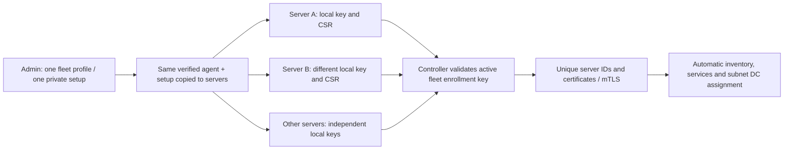

# One agent setup for many servers

Prṛthak 0.10 adds reusable fleet enrollment. Download the agent package once per
CPU architecture and generate **one fleet setup file** in the dashboard. Copy
those same files to 20 servers, 5,000 servers or another deployment size; no
per-server package generation, hostname entry or CSV is required.

Enrollment has no fixed server-count limit. Compute, database, network and
deployment capacity still apply; the existing 5,000-identity policy benchmark is
not a measurement of a simultaneous enrollment storm.

## Configure once, install repeatedly

1. On an installed HTTPS controller, open **Install agent** as Admin or Super
   Admin and choose **Fleet setup**.
2. Set the profile name, controller/control/discovery URLs, polling and expiry.
   Default validity is 24 hours; choose 1 hour through 30 days. Public CA trust
   must remain valid for the selected period. There is no hostname binding.
3. Download the private `prthak-agent-setup.json` once. Its reusable enrollment
   key is returned only on creation; profile listings never reveal it.
4. Stage the verified matching agent archive and the **same** setup file on each
   prepared server. The setup file must be root-owned mode 0600. Use the existing
   deployment tool or secure file transfer; no Prṛthak CSV inventory is needed.
5. From the protected extracted agent directory, run the matching command on
   each server, directly or through deployment automation:

   ```sh
   sudo ./scripts/install-agent-rhel.sh --setup-file /root/prthak-agent-setup.json
   ```

   Ubuntu uses `install-agent-ubuntu.sh` with the same argument. The installer
   selects the bundled CPU binary, enables/starts `seg-agent.service` and keeps
   its existing host-prerequisite checks. It does not prepare OS packages,
   migrate UFW or activate firewall enforcement.



The same AMD64 bundle works across the supported RHEL/Ubuntu AMD64 hosts; use
the ARM64 bundle for ARM64. Neither package contains an endpoint private key or
pre-enrolled identity. Endpoints need no Git, Docker, Python or Go installation.

## Separate bootstrap authority from endpoint identity

Each server generates its own ECDSA private key and CSR locally. The controller
issues a separate certificate and server ID. A shared setup file does **not**
mean shared private keys, certificates or inventory identity. A fresh host
reports its own hostname and interface IPs; the dashboard assigns tags and DCs.

The bootstrap key authorizes new monitor-only enrollment. It grants no dashboard
role, user administration or firewall-change authority. Enforcement and learning
remain separate explicit operations. Preserve existing `/var/lib/seg-agent`
identity/state during reinstall or upgrade; do not clone that directory or
`/etc/seg-agent` credentials into a server image.

Retries with the same key/CSR/hostname are idempotent while the profile and
issued identity remain valid. The same cryptographic key cannot be used to mint
another fleet identity by changing the CSR, profile or hostname. Retirement and
certificate revocation cannot be bypassed by retrying bootstrap.

## Expire or revoke enrollment in the GUI

**Install agent → Fleet profiles** shows profile expiry, state and registration
count. An Admin can revoke a profile. Expired/revoked profiles cannot enroll new
servers or replay enrollment responses. Already enrolled endpoints continue
using their individual mTLS certificates; profile revocation does not disconnect
them or alter their firewalls. Revoke an individual endpoint certificate through
the separate endpoint-certificate workflow when that is the required action.

Treat the setup file as a private enrollment credential: anyone holding it can
enroll while its profile is active. The controller stores only a hash of the
shared secret; it does not put it in public profile data or audit records.
To replace a lost/exposed setup file, revoke the old profile and create a new
one. Restoring a database does not automatically re-enable fleet bootstrap;
create a fresh profile after the recovery checks.

The optional **Individual setup** retains the older hostname-bound, single-use,
15-minute workflow. Older agents keep that path; schema-2 fleet files require
an upgraded agent. Real setup downloads are disabled in the loopback preview.

Upgrade and drain **all controller workers** before creating fleet profiles in
an HA deployment. Older controller code does not maintain the new global key
claims; mixed-version issuance and rolling an old controller back while fleet
profiles are active are unsupported. Existing pre-0.10 certificate records are
censused from retained public issuance responses or fresh verified mTLS. If an
expired/revoked historical record has no retained public-key material, profile
creation stops with an actionable history/census error. It cannot infer a key
from a certificate fingerprint. This does not affect a fresh pilot deployment.

Native RHEL 8/9, Ubuntu 26.04, real DC/Entra and workload acceptance remain
deployment checks. See [the GUI pilot guide](pilot-gui-installation.md).
