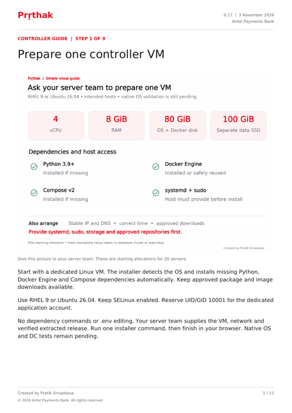
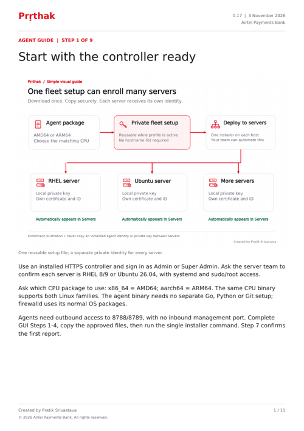

# Simple installation guides

Use the controller guide first, then the agent guide. Each has **nine picture-led steps plus two short reference sheets**, refreshed 3 November 2026 for the 0.17 universal installers. Every page includes **Created by Pratik Srivastava**.

| Install | Read and print | Copy commands in a browser |
|---|---|---|
| Controller on RHEL 9 or Ubuntu 26.04 | [Controller PDF](controller-installation.pdf) | [Controller HTML](controller-installation.html) |
| Agent on RHEL 8/9 or Ubuntu 26.04 | [Agent PDF](agent-installation.pdf) | [Agent HTML](agent-installation.html) |

From the verified, extracted, root-owned controller release:

```sh
sudo ./scripts/install-controller.sh
```

From the matching CPU agent release, with its private GUI setup copied to `/root/prthak-agent-setup.json`:

```sh
sudo ./scripts/install-agent-auto.sh --setup-file /root/prthak-agent-setup.json
```

Both commands detect the supported Linux OS and prepare missing dependencies. The controller opens GUI setup by default. Product configuration stays in the GUI; no manual `.env` or agent JSON editing is required. Existing firewall activity is preserved and new agents start monitor-only.

GitHub previews the PDFs. Download an HTML edition and open it in a browser for copy buttons; all pictures are embedded. Optional transfer/extraction and read-only checks are on pages 10-11 and in the [plain command runbook](../../installation-commands.md). The release must be independently verified before running an installer; the bootstrap cannot authenticate itself before execution.





The guides include ports, authentication, discovery, tags, expected resource allowances and troubleshooting. Read [all features in simple language](../../features-in-simple-language.md) for the full requirement map. Screenshots are labelled actual **synthetic preview** captures, not a real installation. Native RHEL/Ubuntu and DC deployment/pilot acceptance remain deferred.

<sub>Created by Pratik Srivastava</sub>
