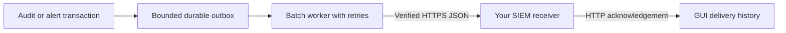
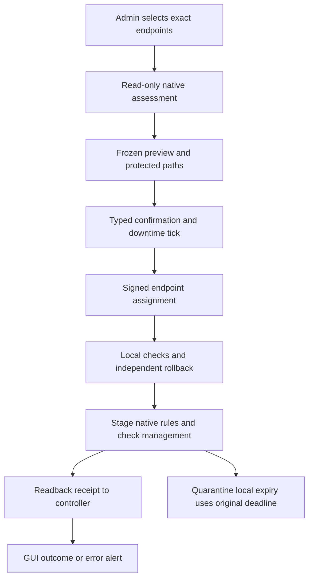

# November audit additions: how to use them

Prṛthak · पृथक् — Airtel Payments Bank. These are code and GUI workflows for the 0.18 pilot candidate. Native OS, real endpoint firewall and DC/DR acceptance remain deployment work.

## Installation profiles

| Component | Installer profiles |
|---|---|
| Controller | Existing RHEL 9 or Ubuntu 26.04, AMD64/ARM64 |
| Agent | RHEL, Rocky Linux, AlmaLinux, Oracle Linux 8/9; Ubuntu 22.04/24.04/26.04; AMD64/ARM64 |

The same reusable private GUI fleet setup and one agent installer command work across these endpoint profiles. Every host creates its own key/certificate. RHEL 7/10 and unknown OS identifiers are refused. Acceptance of an installer profile is not proof of every kernel/firewalld combination. Dependency preparation installs missing `nft` and `sysctl` tools with journaled startup protection for firewalld and nftables. It preserves existing firewall activity and does not activate enforcement. An active or unverified foreign nftables service can block package preparation to preserve its configuration.

## Preview a policy

Open **Policies → Preview impact**, or use the draft editor's impact preview. The controller compiles the existing and proposed intent with the same compiler that produces endpoint policy. Review changed endpoints, effective grants and observed source/port relationships that would lose permitted access. Read Only can inspect an existing policy; Admin is required to preview a proposed change.

No firewall changes happen during preview. Missing traffic, sampling gaps, unmanaged broad rules and unsupported paths make the result uncertain. A missing observed dependency does not prove a proposed block is safe.

## Native firewall rule counters

Open **Firewall → Native rule counters**, choose a server and inspect its latest native sample. These are **packet and byte counters**, including supported firewalld default/base rules. They are not connection counts or exact totals for each dashboard policy.

- An actual native zero is shown as zero. Missing counters or unsupported ownership/backend are **Unavailable**.
- Large uint64 values retain their exact value. Sample deltas distinguish a baseline, reset, changed rule generation and stale data.
- Supported nftables collection is scoped to firewalld-owned tables/chains. Legacy iptables collection covers recognized firewalld/builtin patterns in the **filter** table, not every foreign table.
- Refresh fetches the controller's latest sample; it does not run a command on the endpoint. Normal samples follow full inventory cadence, not every heartbeat. Samples are bounded to keep the 5,000-server policy path separate from high-volume evidence.

On supported firewalld 2+ with the nft backend, native rules may lack counters until **NftablesCounters** is enabled. Use the explicit GUI maintenance operation; it checks actual native support, stages the protected configuration change and performs a reviewed reload with health checks/rollback. This is never enabled simply by opening the counter page. See [upstream configuration](https://github.com/firewalld/firewalld/blob/main/config/firewalld.conf) and [firewalld 2.0 announcement](https://firewalld.org/2023/06/firewalld-2-0-0-release).

## SIEM export

A **Super Admin** opens **Settings → SIEM export**, enters an HTTPS JSON receiver and optional credential, previews the destination and confirms the exact configuration. TLS verification stays enabled; redirects and unsafe destinations are refused. Credentials are encrypted and are not returned in public settings.

Only **future** audit/alert summaries enter the bounded durable outbox. Fixed summaries can include validated source IP, service port and protocol, but arbitrary details, passwords, setup files and private keys are excluded. Stable stream/event/batch identities let the receiver deduplicate retries. Delivery history shows queued, retrying, delivered and failed/overflow conditions. A receiver's HTTP success confirms acknowledgement; verify indexing and alert routing at the receiver separately. This is an HTTPS JSON integration, not a universal vendor-specific syslog adapter.

## Outbound and emergency quarantine

Use the separate **Network controls** page. Ordinary inbound policy remains source + port; this page explicitly addresses outbound **destination CIDRs + ports** and emergency isolation.

1. Select exact servers or saved groups. No endpoint is selected automatically.
2. Request a fresh native assessment. This reads state and does not enable enforcement.
3. Preview the exact operation. Review capability, protection, local opt-ins, current context and protected controller/DNS/network paths.
4. Type the review phrase and manually tick the fresh downtime acknowledgement. The same Admin can confirm; no second approver is required.
5. Follow authenticated endpoint receipts. A queued request is not an applied result.

Outbound controls require the owned, GUI-prepared HOST-to-ANY egress policy. The policy template is prepared in a separate reviewed maintenance reload; ordinary outbound updates use runtime/permanent rule operations without restarting firewalld. Allow selected destination/port pairs, optionally deny other destinations for a selected port, or explicitly tick a whole-output fallback deny. Unselected ports retain existing behavior when the fallback is off. Ordinary outbound firewalld policy covers new connections; established flows may continue under connection tracking. Use the separate reviewed quarantine workflow when established host flows must be contained.

Quarantine is a separate expiring host control. Owned early input/output/forward hooks cover established application flows as well as new traffic, with exact protected management and network-control exceptions. Kernel timeout gates and independent local expiry/recovery prevent extending isolation merely because the controller or agent stopped. Duration is **60–3,600 seconds**, fixed at review time. The dashboard does not claim release solely because its clock passed expiry; it waits for a native receipt and otherwise shows expiry unconfirmed. No conntrack flush is used. Routing/container/namespace or ownership contexts that cannot be proved safe block the operation.

Both controls require the existing local enforcement, firewall-change and whole-host opt-ins. Their signed authority, replay generations, management health and owned journals are separate from ordinary inbound Save/Apply. Changing group membership invalidates the frozen review; future group members are not automatically isolated.

## GUI firewall maintenance

Installation itself does not switch managers. An Admin can separately request assessment and review one of these operations for at most 20 explicitly selected endpoints:

| Operation | What it changes |
|---|---|
| Activate existing firewalld | Starts/enables the existing configuration after exact native assessment and management protection review |
| Supported UFW conversion | Stages only the narrowly supported inbound numeric source/port profile, preserves a protected backup, and switches managers with health/rollback checks |
| Prepare egress | Creates the exact owned HOST-to-ANY template needed before outbound updates |
| Enable native counters | Changes only the verified compatible NftablesCounters setting and performs the reviewed reload |

This is distinct maintenance authority: activation/cutover can affect live traffic even on a monitor-mode agent. It requires its own signed exact job, typed confirmation, downtime acknowledgement, fresh health and independent rollback. It does not silently turn on ordinary inbound/outbound policy opt-ins.

UFW conversion is deliberately restrictive. Routed/NAT rules, unknown before/after hooks, application profiles and custom or unmapped contexts block automatic conversion. Router/bridge/container/namespace contexts, foreign kernel hooks and a mismatch between live UFW rules and their persisted translation also block it. Review/export remains available; do not assume every default Ubuntu UFW configuration qualifies. A failed or uncertain recovery is reported as an error rather than successful activation.

## Automatic signing stays in the controller

Open **Settings → Policy signing** as Super Admin to check the current key identity and actual cryptographic signing, create an encrypted node-local checkpoint, or preview/confirm repair of a missing key. Repair is limited to the **same pinned signing identity** and refuses unsafe/existing key files. No private-key download or offline workstation is required. The active authority is online. Local checkpoints do not provide off-node DR protection, and rotation remains unavailable until explicit agent trust migration is implemented.

## Nightly image assessment

GitHub Actions schedules the existing four-image scan at **02:00 IST daily**, and also runs it for release tags or a manual dispatch. All severities retain the strict gate, incomplete reports fail, and raw reports are kept 30 days. GitHub may delay scheduled jobs; a saved cron is not proof that a future run completed. Use the Actions run and artifacts as evidence. [GitHub scheduling behavior](https://docs.github.com/en/actions/reference/workflows-and-actions/events-that-trigger-workflows#schedule).

## Pilot acceptance boundary

Unit, wire-contract, database and GUI checks demonstrate the supported code paths. Real native RHEL/Ubuntu systemd/firewalld behavior, dual-stack paths, organization SSO, real SIEM delivery, performance under production traffic, and DC/quorum/failover remain deferred. Use monitor-only enrollment before any reviewed live change on the 20-server pilot.

Created by Pratik Srivastava
