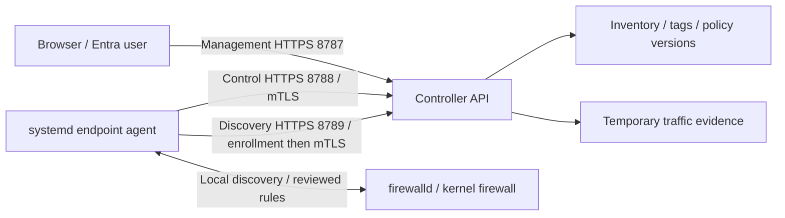

# GUI-configured 20-server pilot (0.10.0)

Configure Prṛthak in the GUI. The installer and fixed local manager generate
protected files; no manual `.env`, agent JSON, token or CA editing is required.
Use one matching installer invocation per prepared host. Later endpoint security
changes use a separately reviewed signed kit and one local apply invocation.
OS preparation, independently trusted release verification/extraction, DNS/LB
routing, time synchronization and private file transfer remain prerequisites.
The browser does not provide a remote shell or silently prepare a DC.

## 1. Prepare the controller and communication paths

Use a RHEL 9 VM with a unique hostname/management IP and the pilot allocation in
the sizing section below. Prepare genuine Linux systemd, a root-owned Python
3.9+ interpreter, Docker Engine and Compose v2 through approved repositories.
The controller image supplies its application runtime and dependencies. Approve
registry/OS/Python package access; the source archive is not an offline image
bundle. Mount persistent storage first; default DATA_ROOT is `/var/lib/prthak`.

Arrange stable DNS, for example `prthak-pilot.example.internal`, and approved
HTTPS certificates. The managed appliance separates these listeners:

| Initiator → destination | Default published TCP port | Purpose and authentication |
| --- | ---: | --- |
| Browser → management controller/LB | **8787** | Dashboard/API; initial private Super Admin credential, then Entra session + CSRF |
| Endpoint → control controller/LB | **8788** | Policy/protection checks and certificate renewal; enrolled endpoint mTLS |
| Endpoint → discovery controller/LB | **8789** | One-use enrollment, then authenticated inventory/reports and temporary evidence |
| Controller → Microsoft Entra | **443** | Discovery, token exchange and signing keys; browser also needs approved Microsoft sign-in/MFA access |

The endpoint initiates HTTPS connections; there is no agent inbound management
listener to open. A configured controller SSH/health probe has its own approved
network path to actual protected service ports; it is separate from agent
polling. Application traffic still reaches the endpoint's normal service ports.

Configure the management, control and discovery public URLs in the GUI/setup
kit, including any non-default port. An approved LB may publish HTTPS 443 using
separate channel origins routed to the corresponding listener. Preserve endpoint
certificates with L4 TLS passthrough; forwarded identity/IP headers do not replace
mTLS. Keep DB/quorum and fixed internal backend ports private. A standalone pilot
does not activate PostgreSQL HA or require voters/watchdogs.



## 2. Stage the verified release and run one controller installer

Obtain `prthak-controller-0.10.0.tar.gz` and its detached `.signature.json`.
Verify exact archive bytes **before extraction/execution**, using an independently
approved public release-signing pin and verifier. A public key downloaded beside
an unknown archive does not establish trust. The project signing authority is
not automatically an organizationally approved production publisher. Stage the
extracted release in a protected root-owned directory and enter it.

```sh
sudo ./scripts/install-controller.sh --gui-setup
```

Git is optional when installing a verified release archive. A source checkout
is a development/distribution choice, not a controller runtime dependency.
No `.env` file is required in this mode. The installer detects a safe management
address and creates private bootstrap settings. Unsafe detection is rejected.
Rerunning preserves installed identity, credentials and GUI-owned configuration.

The installer prints the HTTPS setup URL and the **path** of the private initial
Super Admin credential, not its value. Retrieve it through the approved
privileged secret/file-management channel. Verify initial TLS fingerprint/trust
through that channel before signing in. There is no anonymous remote wizard.

Signed runtime checks cover application source, agent/service bytes and the
configured Docker bootstrap/host-manager startup paths. Mutable GUI settings,
PKI and inventory are separate. This detects release-integrity failures; it does
**not** encrypt the application or protect against an administrator controlling
host root, the signing key or its trust anchor. Keep private release-signing
keys under separate approved custody; endpoints receive public trust only.

## 3. Complete initial GUI setup

1. Open **Settings → Setup** as the initial Super Admin. A local preview cannot
   change an installed controller.
2. Use **HTTPS certificates** to import approved PEM/PKCS#12 material or generate
   a hostname certificate. Establish browser/agent trust in the public CA.
3. Use **Site & cluster settings** to set the site and intended initial origin.
   Finish initial origin preparation before enrollment. Physical addressing,
   DNS/LB routing and real failover remain external. A standalone pilot stays
   one node; managed shared DB activation requires three eligible distinct-site
   voters and approved native watchdog fencing.
4. Return at the exact stable HTTPS origin. Choose the recommended runtime:
   AUTO workers, 32 threads, metadata/traffic pools 8/2 and a 5-second wait.
   SQLite uses one worker; AUTO selects two after PostgreSQL activation. Review
   all controller connections before raising worker/pool counts.
5. In Entra, register a single-tenant confidential **Web** application with the
   exact redirect `https://YOUR-ORIGIN/api/v1/auth/callback`, including its port
   when required. Configure tenant assignment/MFA in Entra; Prṛthak does not
   create directory users or register the application for you.
6. In Setup enable initial Entra configuration. Enter tenant ID, application
   client ID, callback, client-secret value and the first existing user's
   **Object ID**. Review the generated public settings; secrets are not returned.
7. Test candidate sign-in as that exact user. Signature, tenant, nonce,
   PKCE/state and browser binding are checked. This creates no app user/session
   and does not activate the provider.
8. Resume the verified review, type the exact phrase and activate. The fixed
   manager writes protected settings/secret files, supervises restart/readback,
   and retains exact previous material for verified rollback on failure.
9. Sign in normally through Entra. The first permitted identity becomes Super
   Admin; the empty-access-table guard stops subsequent bootstrap grants. In
   **Users & access**, provision additional users as needed. Only Super Admin
   can create any role, including Read Only. No environment cleanup is needed.

Initial Entra activation remains standalone/pre-HA. Active provider changes and
joined-profile convergence use the reviewed flows below; candidate verification
alone is not native OS, live tenant, or external failover acceptance.

## 4. Prepare endpoints

The intended pilot matrix is RHEL 8/9 and Ubuntu 26.04 on x86_64/amd64 or
aarch64/arm64; native acceptance on those VMs remains pending. Prepare `systemd`,
`firewalld`, `ca-certificates`, `util-linux` (for `flock`) and `iproute` (RHEL) or `iproute2` (Ubuntu) through
approved repositories. Family installers check prerequisites; they do not run
apt/dnf, start firewalld, disable UFW or migrate existing rules. Package hooks
may activate services, so stage OS work with management access protected.

Stage and independently verify `prthak-agent-0.10.0-linux-amd64.tar.gz` or
`prthak-agent-0.10.0-linux-arm64.tar.gz`, then extract to a protected root-owned
release directory. Use its signed runtime manifest and independently approved
public trust. The static Go endpoint needs no Git, Python or Go compiler/runtime.

## 5. Download one fleet setup for all endpoints

1. Open **Install agent** as Admin/Super Admin. Choose **Fleet setup**, the
   matching package family/architecture, a profile name and expiry (default
   24 hours; 1 hour through 30 days). No hostname list or CSV is required.
2. Confirm management, control and discovery HTTPS origins and 30-second
   control / 900-second discovery intervals. Central profiles can override
   polling; they do not silently grant local security opt-ins.
3. If web HTTPS and endpoint issuance have different CAs, upload the approved
   **public HTTPS CA chain**. The controller validates its current web leaf,
   hostname, validity and chain. It includes the separate public endpoint issuer.
4. Download `prthak-agent-setup.json` **once**. Reuse this same data/public-CA/
   enrollment-key file across the fleet until its profile expires or is revoked.
   There is no fixed enrollment-count limit. Each endpoint creates a unique key,
   certificate and server ID locally/through enrollment; no identity is shared.
5. Transfer the same setup privately to `/root/prthak-agent-setup.json` on every host, root-owned mode 0600
   (0400 is accepted). Use the distribution tool's permission controls; a browser
   cannot enforce destination ownership. Protect the shared enrollment credential
   and remove unnecessary copies. Never copy initialized endpoint identity/state.

Use **Install agent → Fleet profiles** to view expiry/registration counts and
revoke future enrollment. Existing enrolled endpoints keep their individual
mTLS identities. Optional **Individual setup** retains the earlier single-use,
15-minute, optional-hostname workflow. See [fleet enrollment](fleet-enrollment.md).

Bootstrap is **monitor-only**: `enforce`, imported firewall changes, automatic
learned access and unexpected-port instrumentation are false. The endpoint
creates its own private identity. Do not edit the downloaded JSON.

## 6. Run one matching endpoint installer

RHEL 8/9:

```sh
sudo ./scripts/install-agent-rhel.sh --setup-file /root/prthak-agent-setup.json
```

Ubuntu 26.04:

```sh
sudo ./scripts/install-agent-ubuntu.sh --setup-file /root/prthak-agent-setup.json
```

The bundled helper validates ownership/mode, expiry, exact schema, fleet profile
(or individual hostname), CA trust and monitor-only settings. Signed agent/service integrity is
checked. The installer enables/starts `seg-agent`, preserves existing identity
and refuses unresolved enforcement/rollback transactions. Success still needs
the first authenticated endpoint report, not merely an installed file.

## 7. Confirm inventory and enable explicit capabilities gradually

In **Servers**, verify agent-reported IPs, fresh heartbeat/discovery and actual
listeners. NAT/LB connection source addresses do not replace reported server IPs.
A new service appears after the next successful discovery (15 minutes by
default); failed scans retain the last successful inventory.

Create DC/cloud locations and subnet mappings in the GUI, then assign central
tags individually/in bulk or import exact-IP CSV profiles. Manual assignment
wins; nested subnet mappings use the most-specific prefix. An identical network
cannot be allocated to two DCs. Business tags/DC assignments come from the GUI,
not the agent.

In **Settings → Agent polling**, explicitly save 30-second control and
900-second discovery for the intended freshness profile. Review all scoped
overrides and confirm endpoint receipts of the polling version. Historical
capacity results do not guarantee a real 5,000-endpoint enforcement deadline.

For a fresh endpoint reporting `endpoint_configuration_v1`:

1. Open **Install agent → Configure an enrolled endpoint**. Choose its
   exact host. Select local opt-ins, protected management CIDRs, actual SSH ports
   (including 2022 where used), firewalld zone and channel origins in the GUI.
2. The current Entra Admin/Super Admin saves the exact reviewed configuration
   directly. No checker or selectable approval mode is needed. Local root
   application of the signed kit remains the explicit endpoint opt-in.
3. Download the signed `prthak-endpoint-configuration.json`. Its lifetime is at
   most 15 minutes within the current review. Transfer it as root-owned 0600 to
   `/root/prthak-endpoint-configuration.json`; do not edit it.
4. Run one matching verified family command:

   ```sh
   sudo ./scripts/install-agent-rhel.sh --configuration-file /root/prthak-endpoint-configuration.json
   ```

   For Ubuntu use `install-agent-ubuntu.sh` with the same argument. This wrapper
   checks the platform then invokes the bundled `--apply-configuration` helper.
   There is no manual JSON editing or generic remote command execution.
5. Wait for the exact authenticated configuration receipt. An independent
   90-second rollback timer restores prior config/trust unless the new daemon
   reports the approved result. A download, approval or restart alone is not a
   committed outcome. Old/new control origins must authorize the same existing
   mTLS identity/deployment; current endpoint and assignment-signer trust stay
   pinned. A CA transition needs approved old+new HTTPS trust staged first.

The kit changes only its reviewed local flags/protections/origins. It does not
itself apply a firewall policy, create source-bank ownership, migrate UFW, grant
unreviewed learning authority or bypass native preconditions. Disabling an
opt-in retains committed rules; remove those with their reviewed workflow.
Keep controller/DB/LB infrastructure monitor-only pending ingress acceptance.
Begin temporary learning on selected ports and enable reviewed enforcement only
after native SSH/controller protection and forced rollback checks pass.

## Direct administrative changes

Automatic delivery here applies to ordinary per-port hosts. A host protected by
whole-server default deny keeps its last working rules when its effective
bundle changes, until a fresh dedicated downtime acknowledgement authorizes
that exact replacement.

An authenticated **Admin** or **Super Admin** saves policies, server groups,
service groups and central metadata directly. Saving a managed policy publishes
its effective desired rules; there is no separate rollout approval, checker,
pilot-mode switch, 20-host authorization limit or seven-day consent expiry.
Saved symbolic selectors and group references authorize later source/target
membership resolution. The compiler issues exact per-host versions from that
intent, including newly tagged servers. Every agent still checks its signed
assignment, local opt-ins, protected SSH/controller baseline and rollback health.

A reviewed learned-policy suggestion applies in one Admin action. Starting
explicit automatic learning authorizes the selected hosts and port filter;
a fresh discovery freezes the actual eligible ports, then observed sources can
be allowed automatically within that learning window. No second person approves
initial learning. Protected SSH/controller ports and local auto-allow opt-ins
still apply. Ordinary policy deletion retains its normal confirmation and
revision check.

Explicit deny/destructive imported firewall changes, restrictive learned-policy
removal and database recovery retain **two distinct explicit confirmations by
the same current actor**, with fresh nonces and the exact final typed phrase.
Database recovery is Super Admin only. An active-provider change uses one current
Super Admin's verified candidate and exact Apply action; all-node preparation,
authority cutover and rollback protections remain.

Audit/signed delivery uses `single_admin` evidence bound to the current Entra
identity, exact intent/digest and provider authority epoch. Live role revocation,
stale previews and changed provider authority stop new admission. Old pending
maker/checker or retired pilot reviews cannot be promoted; historical evidence
is retained. Shared bearer tokens cannot authorize installed production firewall
changes. Only Super Admin creates or changes application users and platform
configuration; direct workflow changes no RBAC permission.

## 8. Change an active provider or converge a joined controller

A current **Super Admin** changes Entra tenant/client/callback or secret values.
In **Settings → Setup**, enable provider review and enter
the candidate values. Same-tenant verification uses the requesting Super Admin;
a new tenant requires the exact reviewed target Super Admin Object ID. The
candidate signs in without receiving app access. The same current Super Admin
applies the exact frozen review once.

Keep previous credentials and callbacks valid through completion. If the
callback origin changes, keep both HTTPS aliases/certificates reachable. Setup
provides a two-minute, one-use verification code: open the exact candidate-origin
verification page, enter the code there, finish Microsoft sign-in, then return
and refresh the original review. The code is not a URL, app session or role grant.
Normal sign-in at an old alias moves to the reviewed canonical origin before
setting the host-only OIDC binding cookie.

Every registered controller must prepare its exact local revision/digest, apply,
and verify before shared provider authority cuts over. Peers retain their own
runtime/listener settings; runtime changes in this review affect its creator
controller. A failed member holds or triggers retained rollback; an offline
member is not counted as success. Fingerprint **and opaque provider epoch** gate
human/control authorization, readiness and future controller joins. Sessions and
unfinished approval authority are invalidated at cutover; fresh review is
required. A new tenant grants only the exact verified target Super Admin and
retires old-tenant accounts. Provision additional new-tenant users as needed after sign-in.

When Setup reports a joined encrypted-profile/file mismatch, use its reviewed
**convergence** path and fresh current-Super candidate sign-in. The fixed manager
copies effective provider material into protected managed files; old profile
values cannot shadow it at restart. Retained profile/files support rollback.
Do not repair the mismatch by manually editing `.env` or disabling guards.

## 9. Change channel ports with an existing fleet

Use **Settings → Setup** for control/discovery ports and the existing application
port controls for management. Ports must be distinct and avoid protected service
ports. With enrolled servers, changing agent publishers requires the explicit
alias acknowledgment in the exact review: retain **both old and new agent URLs**
through an externally configured LB until signed endpoint transition kits are
applied and verified. This operation changes node publishers; it does not
configure DNS/LB aliases or provide seamless direct-port migration. Keep the
previous paths available throughout the rollout.

## Expected CPU, RAM and storage

These are planning allocations, not measured limits or a production sizing guarantee.

| Endpoint agent item | Historical evidence / starting allowance |
| --- | --- |
| Agent RSS | **10.42 MiB median; 12.50 MiB maximum** |
| Agent plus active read helpers | **56.79 MiB sampled memory peak** |
| Stabilized CPU | Agent **0.046% of one core**; including completed helpers **0.216% of one core** |
| Monitoring allowance | Start with **128 MiB RAM** for the agent and helpers |
| Temporary-learning allowance | Start with **256 MiB RAM**; source cardinality and event rate affect usage |
| CPU allocation | The passive sample did not require a dedicated core; discovery/learning bursts and current-release utilization remain unqualified |

The historical sample was **95 seconds in an Ubuntu 26 ARM64 container**, with
an empty policy and **60/900-second** control/discovery timing. It predates 0.7,
used no enforcement or learning, and excludes firewalld/D-Bus, kernel/source-set
memory and journal storage. It is not native RHEL/systemd acceptance. The current
GUI profile is 30/900 seconds, so these numbers do not measure that workload.
Peaks are sampled observations, not enforced resource limits. Application and
host firewall resources need their own allowance. Preserve the original
[agent resource method and evidence](agent-resources.md) when interpreting them.

| Controller deployment role | Starting CPU | Starting RAM | Persistent allocation |
| --- | ---: | ---: | --- |
| Single-controller 20-server pilot | **4 vCPU** | **8 GiB** | **100 GiB SSD**, plus an **80 GiB OS/Docker disk** |
| 5,000-endpoint management-only controller | **8 vCPU** | **16 GiB** | **100 GiB SSD per node**; size OS/images separately |
| Combined controller/PostgreSQL/etcd voter | **8 vCPU** | **32 GiB** | **300 GiB SSD per node**; size OS/images separately |

Controller CPU utilization has no qualified fixed percentage. Polling, discovery,
policy/source cardinality, concurrent observations, retention, synchronous DB
writes and backups affect CPU, RAM and disk. Monitor the pilot and size backup
storage separately. HA uses three distinct-site DB/quorum voters; the managed
installer co-locates controller/PostgreSQL/etcd on voter VMs. Additional members
can be management-only. A separately dedicated DB topology is not a drop-in
change to this installer. These allocations match the [README sizing scope](../README.md#expected-cpu-ram-and-storage).

## Pilot acceptance and evidence

Start with a small mixed subset, confirm all 20 hosts in inventory, then exercise
bounded learning, direct Admin changes and same-actor deny confirmations. Record each
host's versions, current policy/config digest, protection checks and observed
rollback outcome. Use [authentication acceptance](authentication.md),
[Linux validation](linux-validation.md), [capacity scope](controller-capacity-5000.md)
and the original [resource measurements](agent-resources.md).

Fresh 0.7 release evidence is recorded with its exact source/configuration and
skips; this runbook supplies no invented test totals. Native RHEL/Ubuntu systemd,
firewalld/SELinux/SSH checks, the real 20-server pilot, live Entra/MFA, DC/WAN
partitions, watchdog fencing and a real 5,000-endpoint workload remain external
acceptance work. A standalone pilot or locally signed identity fixture does not
validate HA, an organization tenant or production readiness.


## Optional whole-server default deny

After native lockout acceptance, use [Policies → Whole-server default deny](whole-server-default-deny.md) for a small explicit server/group scope. The endpoint needs the separate local opt-in and compatible agent; every push requires a fresh manually checked downtime acknowledgement. Monitor rows do not grant access through the global fallback. Existing sessions and the declared network-control exceptions are preserved. Review the exact affected servers and verify receipts; adding future group members never silently enables this option.


## Native traffic capture in 0.9

Upgrade controller and endpoints before creating new learning/monitor scopes. They require `traffic_capture_v1`, with accepted connections and denied packets selected independently or together. Historical log-only sessions remain labelled legacy. Unsupported native contexts and missing coverage are shown; there is no silent journal fallback. See [the capture guide](traffic-capture.md) before enabling per-port automatic grants from denied hits.
