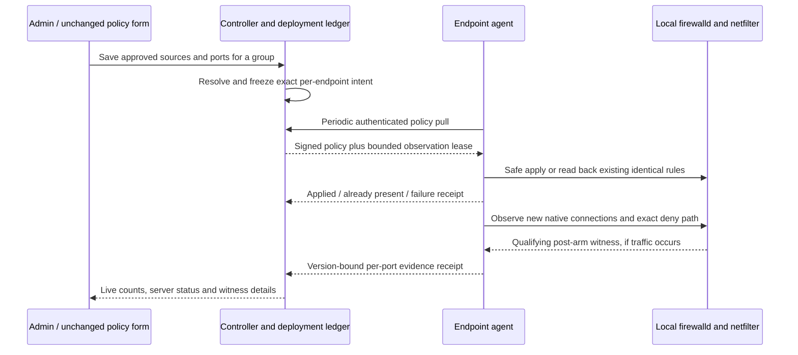

# Policy application and traffic verification

The policy form stays the same across supported RHEL and Ubuntu endpoints:
target servers/groups/tags, allowed sources, exact ports and protocol. The
controller resolves membership and sources into versioned, signed intent. The
local agent uses its reported firewalld capabilities and checks its actual
runtime/permanent rules. Unsupported layouts remain explicit errors rather
than being translated into an unsafe approximation.

## Follow a bulk change

Saving an ordinary policy creates a durable deployment record with the exact
affected endpoints and their expected versions, digests, authorization,
protection and IP bindings. The top-right **Rollouts** panel remains available
across dashboard pages. Counts cover the frozen scope; server details are
paged rather than loading a 5,000-server evidence matrix into the browser.

Each server has two independent results:

| Result | What establishes it |
| --- | --- |
| Applied | Fresh agent readback of the exact authorized bundle, with management safety checks |
| Already present | The same readback succeeded through the agent's existing-rule path without an access-rule write |
| Awaiting traffic | Installed rules have no qualifying witness yet |
| Traffic verified | Every applicable allow/deny check on every selected port has one admitted native witness |
| Unavailable | The endpoint cannot provide the required provenance or capture support |
| Unverified | The bounded observation window ended without all required witnesses |
| Failed / Rolled back | Application or safety checks failed; the recorded endpoint outcome determines the result |
| Superseded | A new policy, changed context, restart or recovery invalidated this observation attempt |

An allowed observation on 443 does not validate its denied-source check, port
22, or another server. Where a case does not apply—for example no business
source is allowed—it needs no witness. Protected management/SSH exceptions are
excluded from deny checks and cannot validate a business allow unless the
source also belongs to that explicit allowlist.

## Evidence boundaries

The default observation lease lasts ten minutes and covers at most 64 exact
TCP/UDP pairs per endpoint. It does not create learning sessions, automatically
allow sources, generate business probes, restart firewalld, or change sysctls.
Existing continuous hit monitoring and learning remain separate features.

Allowed evidence requires a confirmed native connection lifecycle born after
the fresh readback/arming boundary. Old established sessions, generic flow
history and receive timestamps cannot prove a new allow. Linux kernels often
have conntrack birth timestamps disabled; the agent reports that limitation
instead of enabling them or manufacturing success. See the official
[conntrack timestamp setting](https://docs.kernel.org/networking/nf_conntrack-sysctl.html).
Normal multicast notifications can omit birth metadata even when enabled.
During an active verification scope, the agent can issue bounded, read-only
kernel GET requests and accepts the returned start time only after verifying
the exact connection ID, zone and both tuples. Rate limits, missing metadata or
an identity race never permit an inferred timestamp or a fabricated pass.

Denied evidence uses temporary, logging-only NFLOG instrumentation immediately
before a verified owned terminal deny. Its prefix binds the observation lease,
applied generation, capture epoch, port, protocol and address family. Earlier
unmanaged rules or unsupported ordering can make this check unavailable.
Logging is bounded and rate limited; this is a first-witness check, not a
complete packet ledger.

An Admin can choose **Observe again** for an existing target to create a fresh
passive window without editing policy. Changed policy/address/protection
bindings require inspecting the current publication instead. Read Only users
can inspect status and evidence but cannot start rechecks. Logout or identity
changes clear the browser's status state; unavailable controller polling is
shown as stale rather than successful.

Exact duplicate rows, source aliases and overlapping group permissions are
deduplicated during compilation. The agent skips an existing identical owned
rule after readback. Different sources, conflicting verdicts and uncertain
concurrent ownership remain real changes or errors; foreign rules are never
silently adopted or deleted during rollback.

A witness confirms one observed transport decision under the installed policy.
It does not prove every possible source, business dependency, application
response or future connection. Native RHEL/Ubuntu and DC acceptance remain
separate pilot work.

Created by Pratik Srivastava
