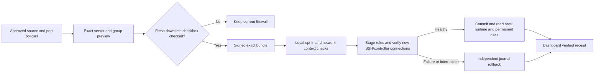

# Whole-server default deny

Prṛthak 0.8 adds an optional allowlist for new inbound traffic to a selected
server. Approved managed source/port grants are evaluated before an owned final
REJECT fallback. Both IPv4 and IPv6 are covered. The kernel enforces the rules;
application traffic continues to travel directly to the endpoint.

The option starts disabled. An ordinary policy save never enables it. Every
new deny-bearing bundle needs a fresh, manually checked downtime acknowledgement
from the current authorized Admin. No second administrator is required.

## Enable through the GUI

1. Upgrade the controller and selected endpoint agents to 0.8 or a compatible
   release reporting `host_default_deny_v1`.
2. Use the server's endpoint-configuration GUI to prepare its signed local
   configuration kit. Enable managed enforcement and the separate
   `allow_host_default_deny` opt-in, specify restricted management sources and
   every actual SSH port, and keep automatic learned grants disabled. Apply
   that private kit locally through the existing one-command workflow. This
   opt-in alone does not install a whole-server reject rule.
3. Create or review ordinary **enforce** policies containing every approved
   application source/port combination. Monitoring policies are observations
   and do not grant access through the fallback.
4. Open **Policies → Whole-server default deny**. Select explicit servers,
   saved groups or both, then prepare an enable review.
5. Inspect the exact current group members, each host's allowed sources and
   ports, SSH/controller protection, IPv4/IPv6 controls and blockers. Future
   members of a selected group are not automatically opted in.
6. Manually tick **I understand unapproved inbound connections will be blocked
   and this can cause downtime.** The box starts unchecked. Push is unavailable
   until the current exact review is eligible and the box is checked.
7. Check the endpoint receipts. Queued intent is distinct from verified
   application. A blocked, rolled-back or uncertain endpoint is shown explicitly.

The review expires after ten minutes. Changes to its hosts, group membership,
policy, protected network context or configuration require a new review and a
fresh tick. Retrying an old nonce cannot authorize another push. A failed or
ambiguous network request is not automatically resubmitted.

## What remains reachable

The reviewed allowlist includes the effective **enforce** service grants and
protected SSH access from the configured management networks, including SSH on
nonstandard ports such as 2022. The agent verifies a new authenticated
controller connection and fresh SSH-banner reachability before and after
application. Outbound controller connections retain their stateful return path.

The declared `host-inbound-control-v1` profile also preserves ICMP/ICMPv6 and
DHCP-client UDP ports 68/546. The preview names these exceptions. Loopback and
established/related traffic retain the verified firewalld base handling.
Existing connections are not forcibly terminated; no conntrack flush is used.

The fallback is host INPUT only. It does not create outbound segmentation or
container/forwarding enforcement. NAT/DNAT, active routing, foreign rule tables,
ambiguous zone bindings, unsupported policies/direct rules and competing rule
priorities can prevent a safe proof; those contexts are blocked rather than
reported as protected. A zone's forwarding flag alone does not establish that
the server is actively routing traffic.

## Later changes and removal

Changing an allowlist or its resolved tag/group sources on an already protected
host compiles new desired intent, but cannot silently authorize a new fallback
generation. The last working firewall remains in place until an Admin reviews
the changed matrix and manually acknowledges its push. Observation-only traffic
learning can continue; automatic learned grants and imported-rule mutations are
held while whole-server enforcement or its removal remains active.

To disable, prepare a dedicated disable review and check its acknowledgement.
This removes only the owned global fallback and retains the last authenticated
applied ordinary grant matrix. Pending allowlist edits are not folded into that
removal. The controller resumes normal compilation after a matching successful
removal receipt. Disabling the local opt-in alone leaves committed rules intact;
the dedicated removal path remains available to remove owned protection.

## Transaction and test boundary

Assignments, effective versions/digests, the current configuration receipt and
protected context bind the exact authority. The agent stages runtime rules
ahead of the committed generation, arms the independent rollback watchdog,
checks fresh management health, commits permanent rules and verifies read-back.
Failed or interrupted application compensates its journal. Refused or uncertain
rollback is an error and remains visible.

The GUI uses recently received authenticated snapshots. A snapshot is not a
live kernel probe: the agent may reuse discovery data between scheduled scans.
The endpoint reads the current native context again before application and
refuses changed or unsupported conditions rather than applying a stale review.
Preflight/read-back work can spawn firewalld helpers; the passive resource
measurement in [agent resources](agent-resources.md) does not measure this
enforcement workload.

Code regressions, isolated Linux kernel checks and signed-delivery acceptance
are recorded with the release. Native RHEL 8/9, Ubuntu 26.04, SELinux/systemd,
actual bastion routes and DC/DR acceptance remain required before the real
20-server enforcement pilot. Use a small canary scope with approved application
reachability tests before extending a rollout.

Created by Pratik Srivastava
